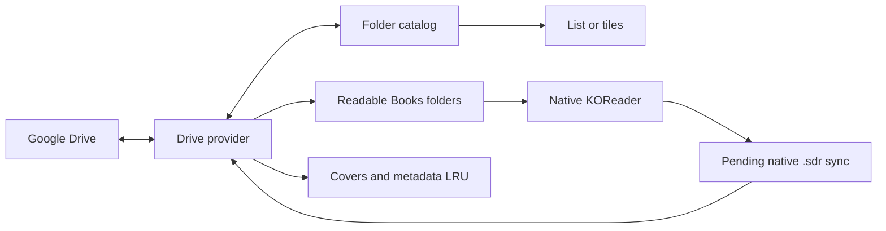

[Русская версия](README.ru.md)

<p align="center"></p>
<h1 align="center">Google Drive Shelf</h1>
<p align="center"><strong>Your Google Drive library, inside KOReader.</strong><br>Browse books and comics, keep them offline, and sync native reading progress.</p>
<p align="center"><a href="../../releases">Download</a> · <a href="docs/authentication.md">Connect Google Drive</a> · <a href="../../issues">Report an issue</a></p>

Google Drive Shelf is an unofficial KOReader plugin. It downloads a complete document before opening it with KOReader's native reader, so your usual reading modes, cropping, zoom and end-of-document actions remain available. English and Russian interfaces follow KOReader's language setting.

## Get started

1. Download **`gdriveshelf.koplugin-<version>.zip`** from [Releases](../../releases).
2. Copy the enclosed **`gdriveshelf.koplugin`** folder into `koreader/plugins/` and restart KOReader.
3. Follow the [authorization guide](docs/authentication.md), then choose the generated credentials JSON on the plugin's connection screen. Android's Downloads folder is fine.
4. Browse to your library and long-press its folder to **Set as home folder**.
5. Tap a document to download and read it. Use the offline-download actions to keep files indefinitely.

The installation ZIP contains only the plugin folder. The separate **`gdriveshelf-authorize.py`** release asset runs on your computer with Python 3 and your own Google OAuth **Desktop app** client:

```sh
python3 gdriveshelf-authorize.py --client /path/to/client.json --output /path/to/gdriveshelf-credentials.json
```

Import the **resulting credentials file**, not the OAuth client JSON. It contains private tokens: never commit it or attach it to an issue.

## A library you can reach quickly

Open **Google Drive Shelf** directly from KOReader's right-hand menu tab in the file browser or reader. You can also select it in **Start with**, or assign **Google Drive Shelf: open home folder**, **history**, or **current document folder** under the gesture editor's **General** actions.

The folder toolbar separates navigation, refresh, sorting, display mode and actions. Folder and file sorting are independent and persist across restarts. Folder pins stay above other items; optionally, known folders follow them. Pinning a folder to the top does **not** download it.

| Folder library | Folder tiles |
| --- | --- |
| Folders with cached information | Folder cards with covers or centered names |
| Settings | Storage |
| Grouped plugin settings | Storage pools and disk usage |

Long-press a file or folder for downloads and other actions. The selection mode lets you keep several files offline at once. Folder rows show known document counts, downloaded size and a rough opened-chapter bar. Unknown counts remain unknown; a matching `.sdr` indicates an opened document, not a completed chapter.

| Folder actions | Document information |
| --- | --- |
| Folder actions and offline downloads | Cover and descriptive metadata |

Plugin history groups comics by folder and keeps ordinary books as individual entries. CBZ/CBR/CB7 are detected as comics; other formats are books. A folder's **Content type** can override this, including for PDF comics. History survives archive eviction.

## Downloads and offline reading

A download shows its name, transferred bytes and verification stage. **Cancel** stops opening it; **In background** continues downloading without opening it later. The same feedback appears when the next chapter is still downloading at the end of a document.

Before travelling, save the folders you need and enable **Offline mode**. Cached files open without a server request. Going online resumes pending progress uploads. KOReader must remain running for background work.

| Storage pool | Default budget | Removal |
| --- | --- | --- |
| Temporary reading cache | 3072 MiB | Automatic LRU |
| Offline downloads | No separate limit | Manual |
| Covers, listings and previews | 256 MiB | Automatic LRU |

The plugin keeps a **512 MiB free-space reserve** and protects active documents. Allow enough temporary-cache space for the open and next archives together. Evicting archives preserves reading metadata, snapshots and pending sync.

Documents use readable paths such as **`Books/Series name/01.cbz`**. Duplicate or unsafe names receive a short identifier when needed. Offline pinning keeps the same path. Choose another document folder under **Downloads and storage**; moving files is cancellable and journalled. Original sidecars remain as recovery copies. Versions through 0.1.4 used a different archive layout: those archive paths are not migrated or reused; redownload documents as needed. Saved snapshots and pending sync are retained.

## Covers, metadata and indexing

Adjacent `cover.jpg`, Kotatsu Redo `index.json` and Mylar/Komga `series.json` can supply covers, names, authors and descriptions. Cover and descriptive-metadata downloads have separate switches. Service files and `.sdr` folders are hidden by default.

Optional **Index home folder** checks its immediate child folders without downloading documents or remote SDR contents. New folders are checked immediately; existing folders are rechecked every 24 hours by default. Choose another interval or disable periodic checks. **Refresh** is available directly in the folder toolbar. Source-file versions invalidate cached information.



## Reading progress

Native **End of document action → Open next file** advances inside the current folder; **Ask** keeps KOReader's popup. Comic prefetch follows the saved file order. Prefetching the next ordinary book has its own switch and is off by default.

Cloud sync writes native `<book>.sdr/metadata.<extension>.lua` beside documents on Drive. KOReader may store local metadata beside books, centrally, or by content hash; a local adjacent `.sdr` is **not required**. Other KOReader installations can use the cloud sidecars once the book and sidecar are available as ordinary local files. Everyone with access to that Drive folder can see those sidecars. Disabling sync keeps reading local.

Downloaded Lua metadata is parsed as data, never executed. Conflicts preserve both versions for an explicit choice under **Downloads and sync**. Remote progress does not unexpectedly move an already-open book. Ambiguous duplicate names or changed book versions may require a manual decision.

## Optional experiments

All experimental features start **off**:

- **Expanded information header** adds a collapsible cover and short description above the file list.
- **Chapter thumbnails** unlocks chapter tiles and manual recursive cover scanning. An optional separate switch enables automatic scanning of the home library.
- Remote previews use bounded HTTP ranges to read ZIP32 directories and the first image. Store and Deflate are supported; ZIP64, encrypted, damaged or oversized archives are skipped. No complete remote CBZ is downloaded for a preview, including across combined ranges. Already-cached archives are read locally.

Limits per preview: **1 MiB ZIP directory, 8 MiB transferred, 16 MiB expanded image and 16 megapixels**. Generated images share the metadata LRU. Scanning excludes `.sdr`, supports cancellation and yields to reading. It can use a first-chapter image when no folder cover exists. Preview caches stay local.

## Compatibility and development

Targets the **KOReader 2026.07 API**. Checked with official macOS ARM64 and Android ARM64 builds on an Android 11 emulator. Physical E-Ink refresh behavior remains device-specific. See [validation](docs/validation.md) for evidence and reproducible checks.

Google Docs/Sheets/Slides export and a standalone Android background-download service are not included. HTTPS verification stays enabled; a Mozilla CA bundle is bundled.

```sh
make test
make package VERSION=0.1.5
```

CI checks pull requests and automatically publishes versioned plugin-only archives and SHA-256 checksums on pushes to `master`. Include your KOReader version and reproduction steps in [issues](../../issues), with credentials removed.

## License

Original code: [MIT](LICENSE). Mozilla CA bundle: [MPL 2.0](gdriveshelf.koplugin/CA-BUNDLE.md). Artwork in interface screenshots belongs to its respective copyright holders.
