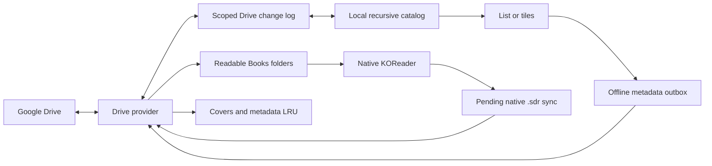

[Русская версия](README.ru.md)

<p align="center"></p>
<h1 align="center">Google Drive Shelf</h1>
<p align="center"><strong>Your Google Drive library, inside KOReader.</strong><br>Browse books and comics, keep them offline, and sync native reading progress.</p>
<p align="center"><a href="../../releases">Download</a> · <a href="docs/authentication.md">Connect Google Drive</a> · <a href="../../issues">Report an issue</a></p>

Google Drive Shelf is an unofficial KOReader plugin. It downloads a complete document before opening it with KOReader's native reader, so your usual reading modes, cropping, zoom and end-of-document actions remain available. English and Russian interfaces follow KOReader's language setting.

| Library | Comic folder and background download | Storage and cache |
| :---: | :---: | :---: |
| Manga library in a three-column grid | Comic folder with a cover, Continue button, chapters and background download | Storage and cache with usage bars and cleanup actions |

## Get started

1. Download **`gdriveshelf.koplugin-<version>.zip`** from [Releases](../../releases).
2. Copy the enclosed **`gdriveshelf.koplugin`** folder into `koreader/plugins/` and restart KOReader.
3. Follow the [authorization guide](docs/authentication.md), then choose the generated credentials JSON on the plugin's connection screen. Android's Downloads folder is fine.
4. Browse to your library and long-press its folder to **Set as home folder**.
5. Tap a document to download and read it. Use the offline-download actions to keep files indefinitely.

The installation ZIP contains only the plugin folder. The separate **`gdriveshelf-authorize.py`** release asset runs on your computer with Python 3 and your own Google OAuth **Desktop app** client:

```sh
python3 gdriveshelf-authorize.py --client /path/to/client.json --output /path/to/gdriveshelf-credentials.json
```

Import the **resulting credentials file**, not the OAuth client JSON. It contains private tokens: never commit it or attach it to an issue.

## Updates with AppStore

After this repository is public, [AppStore](https://github.com/omer-faruq/appstore.koplugin) can install and update the plugin on your reader. Add `mewforest/gdriveshelf.koplugin` by repository URL. For an existing manual installation, use AppStore's **Match repository** action once. Choose the release asset **`gdriveshelf.koplugin-<version>.zip`**, then restart KOReader after updating. Do not choose GitHub's source archives or the development branch for stable updates.

The installed folder name stays `gdriveshelf.koplugin`. Authorization, settings, readable book paths, reading progress, history and pending uploads live outside the installed code and survive updates; no new Google sign-in is needed. Repository discovery and public downloading become available when the owner makes it public. The plugin does not change repository visibility or include its own updater.

## A library you can reach quickly

Open **Google Drive Shelf** directly from KOReader's right-hand menu tab in the file browser or reader. You can also select it in **Start with**, or assign **Google Drive Shelf: open home folder**, **history**, or **current document folder** under the gesture editor's **General** actions.

The folder toolbar separates navigation, refresh, sorting, display mode and actions. Folder and file sorting are independent and persist across restarts. Folder pins stay above other items; optionally, known folders follow them. Pinning a folder to the top does **not** download it.

New installations use a **3×2 folder grid** and a **chapter list**. Switch chapters to tiles to use their independent grid preset. Existing display choices are retained.

| Folder list | Settings |
| --- | --- |
| Folders with cached information | Grouped plugin settings |

Long-press a file or folder for downloads and other actions. The selection mode lets you keep several files offline at once. Folder cards show the downloaded count and size at the upper left, with the known total count and size at the upper right. Folder and chapter grids have independent layout presets. Containers show a subfolder count instead. Confirmed empty folders are hidden by default; unknown folders remain visible. A rough opened-chapter bar summarizes reading activity. Unknown counts remain unknown; a matching `.sdr` indicates an opened document, not a completed chapter.

| Folder actions | Document information |
| --- | --- |
| Folder actions and offline downloads | Cover and descriptive metadata |

Plugin history groups comics by folder and keeps ordinary books as individual entries. CBZ/CBR/CB7 are detected as comics; other formats are books. A folder's **Content type** can override this, including for PDF comics. History survives archive eviction.

## Downloads and offline reading

Opening an uncached document shows a download dialog with its name, transferred bytes and verification stage. **Cancel** stops the request. **In background without opening** moves it to the catalog activity row. When the file is ready, tap **Open** in the notification or queue. Transfer details include elapsed time and an estimate when enough bytes have arrived. The same feedback appears when the next chapter is still downloading at the end of a document. A compact activity row in the catalog opens **Downloads and sync**, where background jobs remain visible. Prefetch supports 0–3 following files; downloads run sequentially.

Before travelling, save the folders you need and enable **Offline mode**. Cached files open without a server request. Going online resumes pending progress uploads. KOReader must remain running for background work.

| Storage pool | Default budget | Removal |
| --- | --- | --- |
| Temporary reading cache | 3072 MiB | Automatic LRU |
| Offline downloads | No separate limit | Manual |
| Covers, listings and previews | 256 MiB | Automatic LRU |

The plugin keeps a **512 MiB free-space reserve** and protects active documents. Allow enough temporary-cache space for the open and next archives together. Use **Choose downloads to remove** to find large titles and remove selected offline or temporary archives. Evicting archives preserves reading metadata, snapshots and pending sync.

Documents use readable paths such as **`Books/Series name/01.cbz`**. Duplicate or unsafe names receive a short identifier when needed. Offline pinning keeps the same path. Choose another document folder under **Downloads and storage**; moving files is cancellable and journalled. Original sidecars remain as recovery copies. Versions through 0.1.4 used a different archive layout: those archive paths are not migrated or reused; redownload documents as needed. Saved snapshots and pending sync are retained.

## Light mode

Switch on **Light mode** in the plugin settings. It pauses automatic index checks, previews and detailed page-by-page progress lookups. Prefetch is off by default in this mode. Set a separate chapter count and threshold under **Reading and sync**. Opening a folder uses its saved listing for up to 15 minutes. Use **Refresh** for a fresh listing and to send queued reading progress, or return to the catalog after reading to send it. The subtitle shows when the folder was last checked. Manual downloads, previews and indexing remain available.

## Covers, metadata and indexing

Adjacent `cover.jpg`, `cover.png` or `cover.webp`, Kotatsu Redo `index.json` and Mylar/Komga `series.json` can supply covers, names, authors and descriptions. Cover and descriptive-metadata downloads have separate switches. Service files and `.sdr` folders are hidden by default.

The comic-folder header shows the cover, description and known document totals. Collapse it temporarily to see more chapters. **Continue reading** uses recent reading history or the latest matching native sidecar. If that chapter is complete, the button advances to the next unopened one. Long-press a chapter to change its read status. Downloaded CBZ, EPUB, PDF and supported CBR documents can generate local covers. RAR covers can take longer, especially with solid archives. Download a CBR before choosing a cover from it. A folder without its own cover uses the first available cached-document preview in natural filename order. CB7 cover extraction is not guaranteed by the current runtime.

**Edit folder information** changes the title, description or cover. Edits take effect locally, queue safely while offline, and sync to a separate versioned `gdriveshelf.json` plus immutable cover files. Original `index.json`, `series.json`, `cover.jpg` and native progress are preserved. Conflicting edits retain both versions for a choice under **Downloads and sync**. The editor previews the current cover and lets you import an image, reset to the automatic cover, hide it, or choose a page from a downloaded volume. The quick first-page action can also read a remote CBZ through bounded byte ranges.

| Chapter tiles | Cover editor | Page gallery |
| --- | --- | --- |
| Chapter tiles with a cached cover | Metadata editor with current cover | Choosing a cover page |

Optional **Index home folder recursively** asks for explicit consent and scans the selected home tree, excluding SDR contents. Documents are never downloaded for this catalog. After the first pass, ordinary refresh uses the [Drive change log](https://developers.google.com/workspace/drive/api/guides/manage-changes), with checks on catalog entry and wake limited to once per 30 seconds; manual Refresh checks immediately. **Reindex library** opens a progress screen for a repair pass. Pause it and resume from the saved checkpoint, or let it continue in the background. No shared cloud tree manifest is created. Covers and descriptions are separate low-priority tasks.



## Reading progress

Native **End of document action → Open next file** advances inside the current folder; **Ask** keeps KOReader's popup. Comic prefetch follows the saved file order. Prefetching the next ordinary book has its own switch and is off by default.

Cloud sync writes native `<book>.sdr/metadata.<extension>.lua` beside documents on Drive. KOReader may store local metadata beside books, centrally, or by content hash; a local adjacent `.sdr` is **not required**. Other KOReader installations can use the cloud sidecars once the book and sidecar are available as ordinary local files. Everyone with access to that Drive folder can see those sidecars. Disabling sync keeps reading local.

Downloaded Lua metadata is parsed as data, never executed. Conflicts preserve both versions. The default chooses the farther reading position when the verified file is identical and only the position differs. **Reading and sync** also offers a more-recent policy or manual selection. Open a conflict to compare pages, percentages, status and dates. Remote progress does not unexpectedly move an already-open book. Ambiguous duplicate names or changed book versions may require a manual decision.

## Optional experiments

All experimental features start **off**:

- **Quick CBZ preview** opens a chapter as images from its long-press menu. A remote session reads up to 32 MiB and always less than the full archive. It leaves reading progress and offline downloads alone.
- **Chapter thumbnails** enables remote CBZ previews and manual recursive cover scanning. File tiles and existing local previews also work with this experiment disabled. An optional separate switch enables automatic scanning of the home library.
- Remote previews use bounded HTTP ranges to read ZIP32 directories and the first image. Store and Deflate are supported; ZIP64, encrypted, damaged or oversized archives are skipped. No complete remote CBZ is downloaded for a preview, including across combined ranges. Already-cached archives are read locally.

Limits per preview: **1 MiB ZIP directory, 8 MiB transferred, 16 MiB expanded image and 16 megapixels**. Generated images share the metadata LRU. Scanning excludes `.sdr`, supports cancellation and yields to reading. It can use a first-chapter image when no folder cover exists. Preview caches stay local.

## Troubleshooting

**Offline mode**, **Waiting before retry**, **Waiting for the device to wake**, and **Authorization is required** describe different states. Transient network/server failures retain queued downloads while retrying. A damaged preview or local-file error does not pause unrelated network work. In **Downloads and sync**, retry pending tasks or inspect conflicts; use **Recover reading progress…** only to restore a downloaded cloud copy or the last local snapshot, with the document closed.

Optional **Connection and startup → Diagnostics** records sanitized operation/status counters and queue transitions in the data folder `gdriveshelf/logs`, outside plugin code. Logging starts off and retains at most **2 MiB** across two files. File names, IDs, paths, URLs, credentials and response contents are excluded. Export or clear the log from the same screen. Include an exported log and reproduction steps when reporting a fault.

## Compatibility and development

Targets the **KOReader 2026.07 API**. Checked with official macOS ARM64 and Android ARM64 builds on an Android 11 emulator. Physical E-Ink refresh behavior remains device-specific. See [validation](docs/validation.md) for evidence and reproducible checks.

Google Docs/Sheets/Slides export and a standalone Android background-download service are not included. HTTPS verification stays enabled; a Mozilla CA bundle is bundled.

```sh
make test
make package VERSION=0.1.7
```

CI checks pull requests and automatically publishes versioned plugin-only archives and SHA-256 checksums on pushes to `master`. Include your KOReader version and reproduction steps in [issues](../../issues), with credentials removed.

## License

Original code: [MIT](LICENSE). Mozilla CA bundle: [MPL 2.0](gdriveshelf.koplugin/CA-BUNDLE.md). Artwork in interface screenshots belongs to its respective copyright holders.
