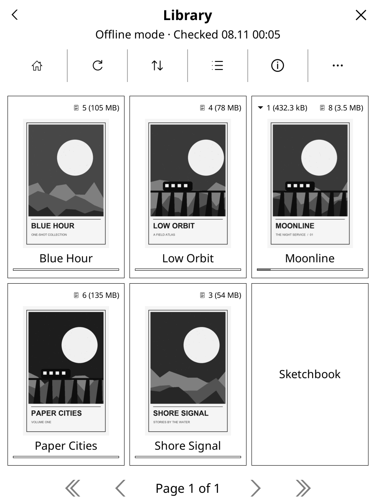
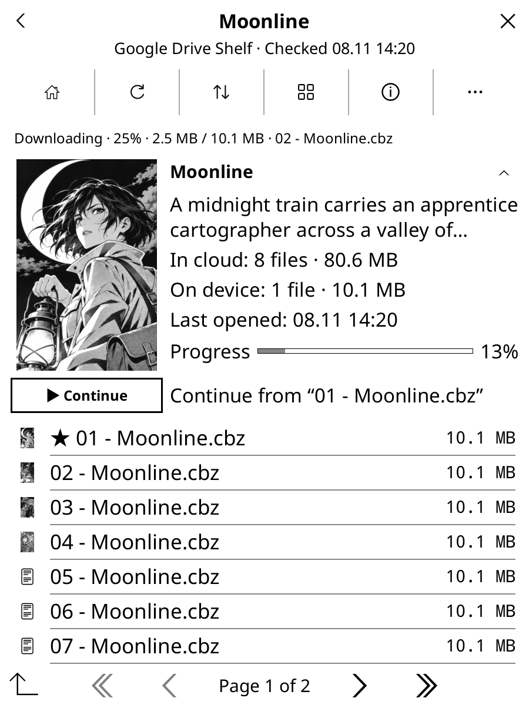
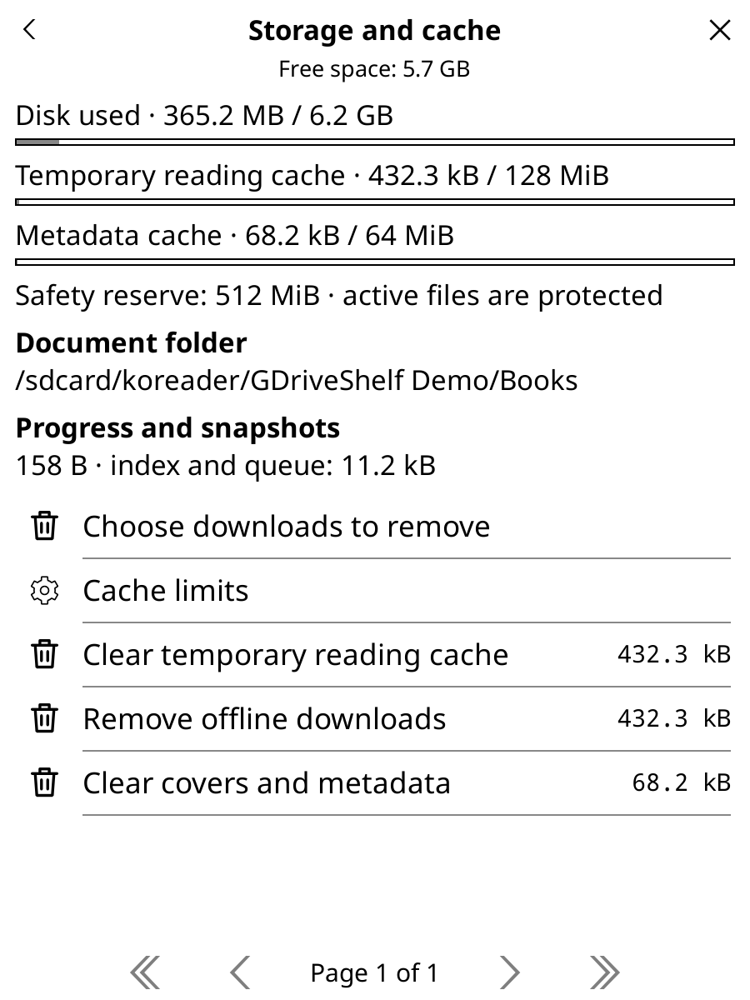
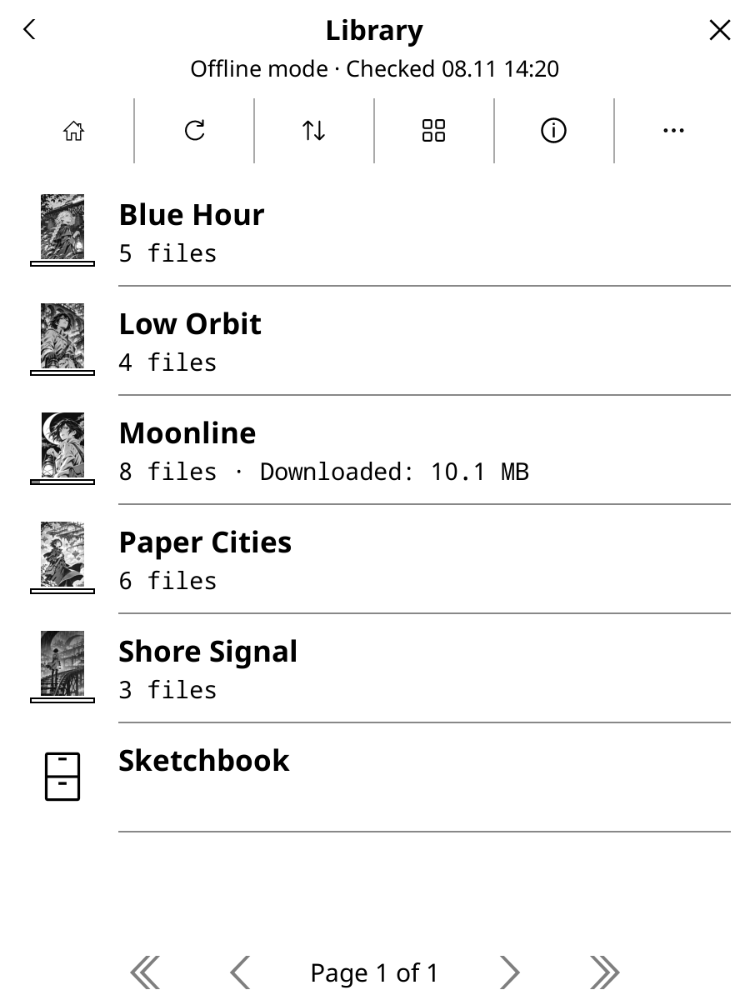
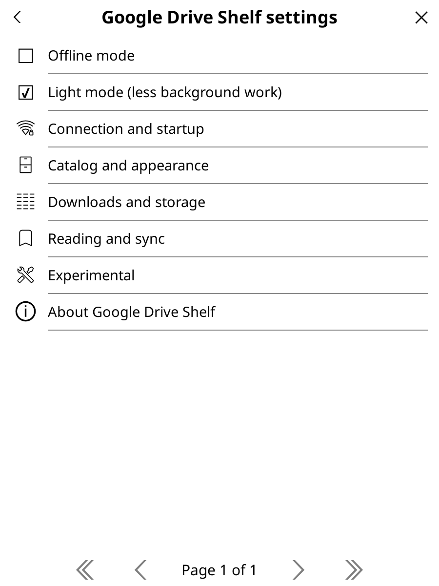
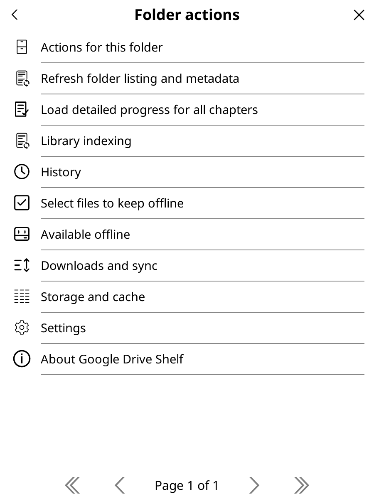
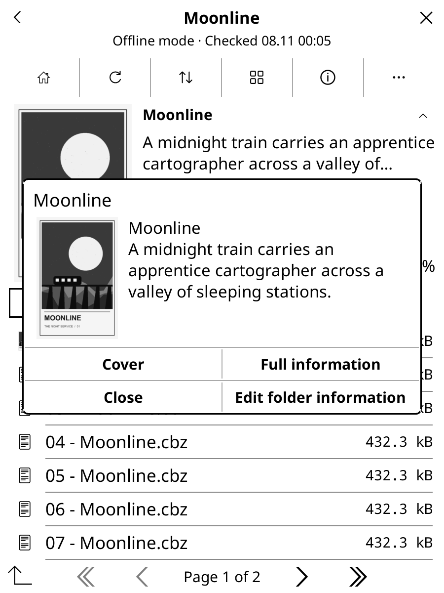
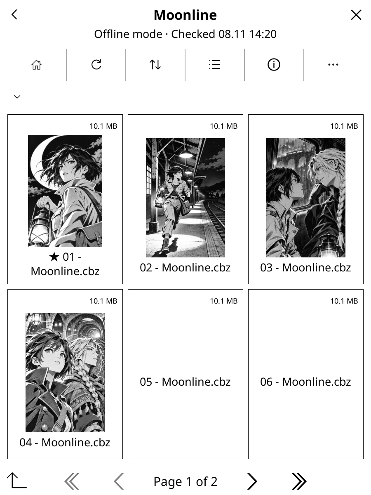
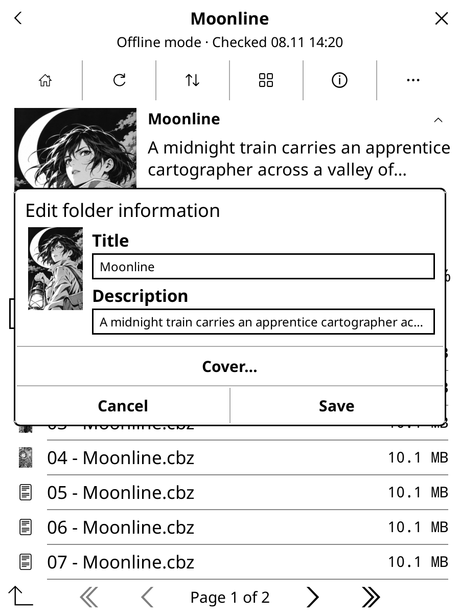
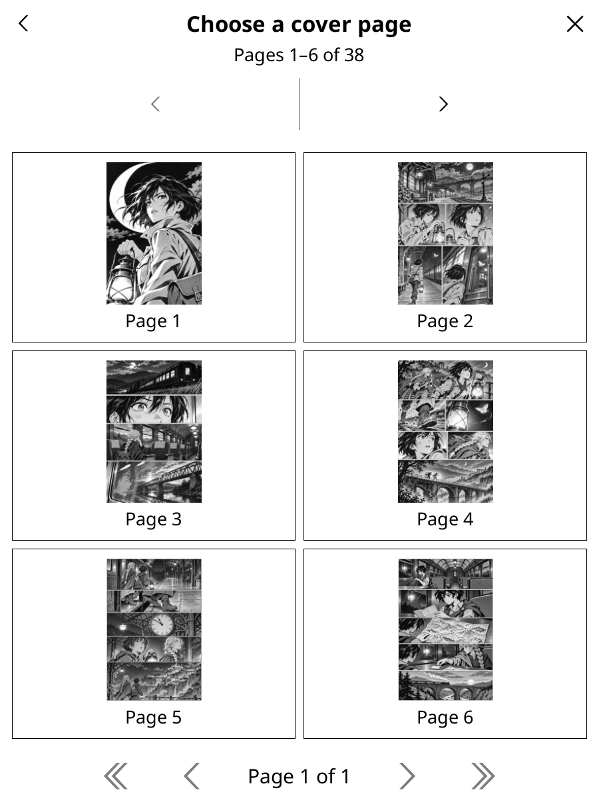

[Русская версия](README.ru.md)

<h1 align="center">Google Drive Shelf</h1>

<strong>Your Google Drive library, inside KOReader.</strong> Browse books and comics, keep them offline, and sync native reading progress.

<a href="../../releases">Download</a> · <a href="docs/authentication.md">Connect Google Drive</a> · <a href="../../issues">Report an issue</a>

Google Drive Shelf is an unofficial KOReader plugin. It downloads a complete document before opening it with KOReader's native reader, so your usual reading modes, cropping, zoom and end-of-document actions remain available. English and Russian interfaces follow KOReader's language setting.

| Library | Comic Folder | Storage and cache |
| :---: | :---: | :---: |
|  |  |  |

## Installation

**Option 1 · AppStore**

1. Open [AppStore](https://github.com/omer-faruq/appstore.koplugin) in KOReader and search for `gdriveshelf`. If it’s missing from your catalog, open the AppStore settings and choose **Install plugin from URL**. Enter `mewforest` as the owner and `gdriveshelf.koplugin` as the repository name.
2. Select **Install plugin**, choose the release asset `gdriveshelf.koplugin-<version>.zip` and restart KOReader.

**Option 2 · Manual installation**

1. Download `gdriveshelf.koplugin-<version>.zip` from [Releases](../../releases).
2. Extract the enclosed `gdriveshelf.koplugin` folder into `koreader/plugins/` and restart KOReader.

## First-time setup

1. For the first connection, use a computer. Download the separate `gdriveshelf-authorize.py` release asset, follow the [Google Drive setup guide](docs/authentication.md) for Windows, macOS or Linux, and save the credentials JSON. The graphical helper opens your browser for sign-in. The guide also covers terminal use and an Android-only Termux option.
2. Open **Google Drive Shelf** from KOReader’s right-hand menu tab. Import the generated `gdriveshelf-credentials.json` using the file picker or enter its path. Android’s Downloads folder works for the transfer. Keep the credentials file private.
3. Long-press your library folder and choose **Set as home folder**. Tap a book or chapter to read it.

## Reading and progress

**Continue reading** opens your last chapter or the next unopened one if you finished it. KOReader opens books and comics in its own reader, with its usual zoom, cropping and end-of-document options. To advance automatically, select **End of document action → Open next file** in KOReader.

Cloud sync is on by default. It saves native `.sdr` reading progress alongside your books on Drive, where anyone with access to the folder can see it. The plugin works with all KOReader local progress storage modes. Turn off **Reading and sync → Sync reading progress (.sdr)** to keep progress on the device.

Sync conflicts and restoring progress

When two devices save different progress for the same version of a book, the default uses the farther position if only the position differs. You can choose the more recent position or resolve conflicts manually. Differences such as bookmarks or read status require a choice under **Downloads and sync**. Use **Recover reading progress…** to restore a cloud copy or local snapshot while the book is closed.

## Downloads and offline reading

Long-press files or folders to save them for a trip. Turn on **Offline mode** to browse the cached library and read downloaded books. When you reconnect, queued progress sync resumes. KOReader needs to stay open for background work.

**In background without opening** keeps a download running and offers **Open** when it finishes. Tap the activity row to see the queue. In **Storage and cache**, **Choose downloads to remove** frees space by folder or file and preserves reading progress.

Cache limits, book paths and moving downloads

Temporary reading downloads default to 3072 MiB and metadata to 256 MiB. Offline downloads stay until you remove them. The plugin reserves 512 MiB of free space and protects active documents. Allow space for the current book and prefetched chapters together.

Books use paths like `Books/Series name/01.cbz`, with a short identifier when a name conflicts. Offline saving keeps the same path. Change the root under **Downloads and storage → Document folder**. You can cancel a move, and original sidecars stay available for recovery. Archive paths from 0.1.4 and earlier are not migrated. Redownloading those books preserves saved snapshots and pending sync.

## Screenshot Library

| Folder list | Settings |
| --- | --- |
|  |  |

| Folder actions | Document information |
| --- | --- |
|  |  |

| Chapter tiles | Cover editor | Page gallery |
| --- | --- | --- |
|  |  |  |

The screenshots show a fictional library with manga illustrations generated for the demo.

## Settings and help

- **Catalog and appearance** changes list and tile layouts, sorting and the comic header. Long-press a folder to pin it or edit its title, description or cover. **Content type** can treat a folder of PDFs as comics.
- **Connection and startup** shows the current startup choice. Use KOReader’s **Start with** menu to open Google Drive Shelf at startup. Under **General** in the gesture editor, assign a shortcut to the home folder, history or current document’s folder.
- **Light mode** reduces automatic indexing, previews and progress lookups. Refresh manually when you want fresh data. Adjust prefetch under **Reading and sync**. It starts at one following chapter in normal mode and zero in Light mode.

Covers, indexing and experimental features

The plugin can use `cover.jpg`, `cover.png`, `cover.webp`, Kotatsu Redo’s `index.json` and Mylar/Komga’s `series.json`. Folder edits sync separately in `gdriveshelf.json` and cover files. A folder without a cover can use a preview from a downloaded chapter. Download a CBR before choosing a cover page from it.

Recursive home-folder indexing is opt-in. After the first scan, it follows the [Drive change log](https://developers.google.com/workspace/drive/api/guides/manage-changes). **Reindex library** runs a new scan and can resume from a checkpoint. The scan skips the contents of `.sdr` folders.

Quick CBZ preview and remote chapter thumbnails are optional. They use bounded ZIP32 byte-range requests and leave reading progress alone. Quick preview reads up to 32 MiB and less than the full archive.

Troubleshooting and compatibility

Check **Downloads and sync** for queued work, retries and conflicts. If the plugin asks for authorization again, see the [connection guide](docs/authentication.md#renew-or-revoke-access). Enable **Connection and startup → Diagnostics** to export a log for a bug report. The journal is off by default and excludes file names, paths and credentials.

The plugin targets the KOReader 2026.07 API. See [validation](docs/validation.md) for macOS and Android test details. If you [report an issue](../../issues), include your KOReader version and steps to reproduce it.

Update with AppStore

If you installed manually, use **Match repository** in AppStore once to link the existing installation to `mewforest/gdriveshelf.koplugin`. Choose the release asset `gdriveshelf.koplugin-<version>.zip` when updating and restart KOReader. Settings, authorization and reading progress are preserved.

Develop and build

Run `make test` or `make package VERSION=0.1.0` from the source checkout. CI publishes a plugin-only ZIP, the standalone authorization helper and their SHA-256 checksums.

## License

Code is [MIT](LICENSE). The bundled Mozilla CA list is [MPL 2.0](gdriveshelf.koplugin/CA-BUNDLE.md).
