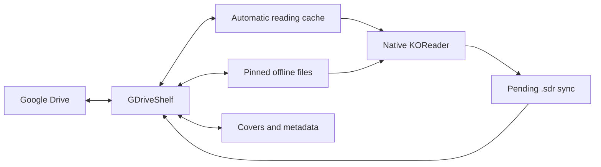

[Русская версия](README.ru.md)

<p align="center">
  
</p>
<h1 align="center">GDriveShelf</h1>
<p align="center"><strong>Your Google Drive library, inside KOReader.</strong><br>Download whole chapters, read with KOReader’s native controls, and keep your library available offline.</p>

GDriveShelf is a KOReader plugin for browsing and reading books and comic archives stored on Google Drive. It downloads the complete file before opening it in KOReader, so zoom, cropping, two-page spreads, and reading modes work as they do with a local book.

[Download a release](../../releases) · [Connect Google Drive](docs/authentication.md) · [Report an issue](../../issues)

## Get started

1. Download the ZIP from [Releases](../../releases).
2. Copy `gdriveshelf.koplugin` into `koreader/plugins/`, then restart KOReader.
3. Follow the [authorization guide](docs/authentication.md) to create a credentials JSON, then open **GDriveShelf → Choose authorization JSON**.
4. Browse to your library folder and use its folder actions to make it your home folder.
5. Tap a chapter to download and open it. Long-press a file or folder for offline downloads and other actions.

Authorization uses Python 3, your own Google OAuth **Desktop app** client, and your system browser:

```sh
python3 tools/authorize.py --client /path/to/client.json --output /path/to/gdriveshelf-credentials.json
```

The installation ZIP contains only `gdriveshelf.koplugin/`. Download [gdriveshelf-authorize.py](https://github.com/mewforest/gdriveshelf.koplugin/releases/latest/download/gdriveshelf-authorize.py) separately from the same release and use that filename instead of `tools/authorize.py`. Your Google password is entered only on Google’s website. Treat the resulting JSON as a private credential; do not upload it to an issue or commit it to Git.

<details>
<summary>First-run setup screen</summary>

First-run connection setup with direct JSON chooser, path entry and help

</details>

## A familiar reading experience

| Library and progress | Library details |
| :---: | :---: |
| Google Drive chapter list with download and reading status | Library title, author, tags, description, and cover |
| **Storage controls** | **Settings** |
| Space usage and separate cleanup controls for three storage pools | GDriveShelf settings in KOReader |
| **Title library** | **Library and actions** |
| Title folders with a cached cover, series title and author | Library navigation, resume reading, folder actions and title sorting |

## What it does

- Browse Drive folders with natural chapter sorting and a configurable home folder.
- Browse title folders with cached covers, series names, and authors. Sort titles separately by name, last opened, or date added; both sort settings persist across restarts.
- Resume the last document from **Library and actions**, with native reading progress and next-chapter prefetch when online.
- Read downloaded files offline and pin individual files or whole folders for later.
- Prefetch the next chapters within the current title’s folder.
- Show covers and descriptions from adjacent `cover.jpg`, Kotatsu Redo `index.json`, and Mylar/Komga `series.json` files.
- Sync native KOReader `.sdr` reading data beside the books on Drive, including changes saved while offline.
- Review sync conflicts and choose which version to keep.
- Follow KOReader’s language setting, with English and Russian interfaces and an English fallback.



## Offline storage

| Pool | Default budget | Cleanup |
| --- | --- | --- |
| Automatic reading cache | 3072 MiB | Least recently used files, automatically |
| Pinned offline files and folders | No separate limit | Manual |
| Covers, listings, and remote metadata | 256 MiB | Least recently used files, automatically |

GDriveShelf reserves **512 MiB of free space** on the storage volume and protects the open book. Removing cached archives preserves local `.sdr` data, progress snapshots, and pending sync.

Before travelling, download the folders you need and enable **Offline: block network** in Settings. Cached chapters open without a server request. When you go online again, pending progress can sync even for books you have already closed. KOReader must remain running for downloads and background work.

## Reading progress and compatibility

**Title sorting** is available in **Library and actions** and **Settings**. Last-opened order tracks books opened through GDriveShelf on this device. Date-added order uses the folder's Drive creation date, falling back to the first time GDriveShelf saw it. Covers and series names appear once the folder metadata has been cached; opening a parent list does not scan every child folder.

Cloud progress does not unexpectedly move an open book to another page. You can explicitly apply saved cloud progress and resolve conflicts from **Queue and sync**.

A folder such as `Book.sdr/metadata.cbz.lua` is native KOReader data. Another KOReader installation can use it when the book and its `.sdr` folder are available as ordinary local files. The plugin handles access to Drive; cloud sidecars alone do not give KOReader direct Drive access. Duplicate names and changed book versions may need a manual decision.

GDriveShelf targets the **KOReader 2026.07 API**. Integration has been tested in the official macOS ARM64 build; validation on physical Android readers remains important. See the [validation guide](docs/validation.md) for coverage and reproducible checks.

Google Docs, Sheets, and Slides are not exported. There is no dedicated shared-drive selector or standalone Android download service. Service files are hidden by default, and links or remote images inside metadata are not opened automatically. HTTPS certificate verification is enabled; a Mozilla CA bundle is included.

## Help and development

For a bug or feature request, [open an issue](../../issues). Include your KOReader version, platform, steps to reproduce, and a credential-free error message or screenshot.

With LuaJIT and Python 3 installed:

```sh
make test
make package VERSION=0.1.0
```

The package command checks syntax, runs tests, and builds a ZIP with a SHA-256 checksum. See [validation](docs/validation.md) for native KOReader and optional Drive integration checks. Pull requests are welcome. CI checks pull requests and publishes versioned releases after pushes to `master`.

## License

Original code is licensed under [MIT](LICENSE). The included [Mozilla CA bundle](gdriveshelf.koplugin/CA-BUNDLE.md) uses MPL 2.0. Artwork shown in screenshots belongs to its respective copyright holders and is used to demonstrate the interface.
