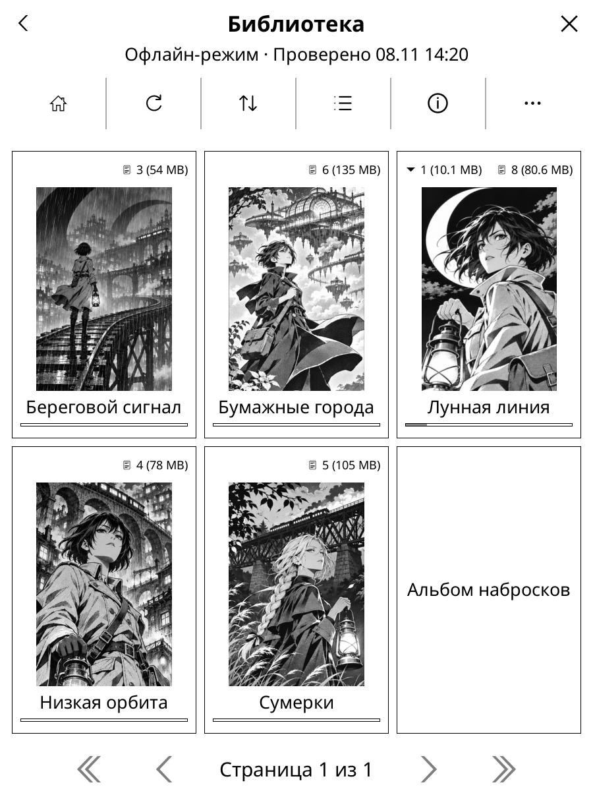
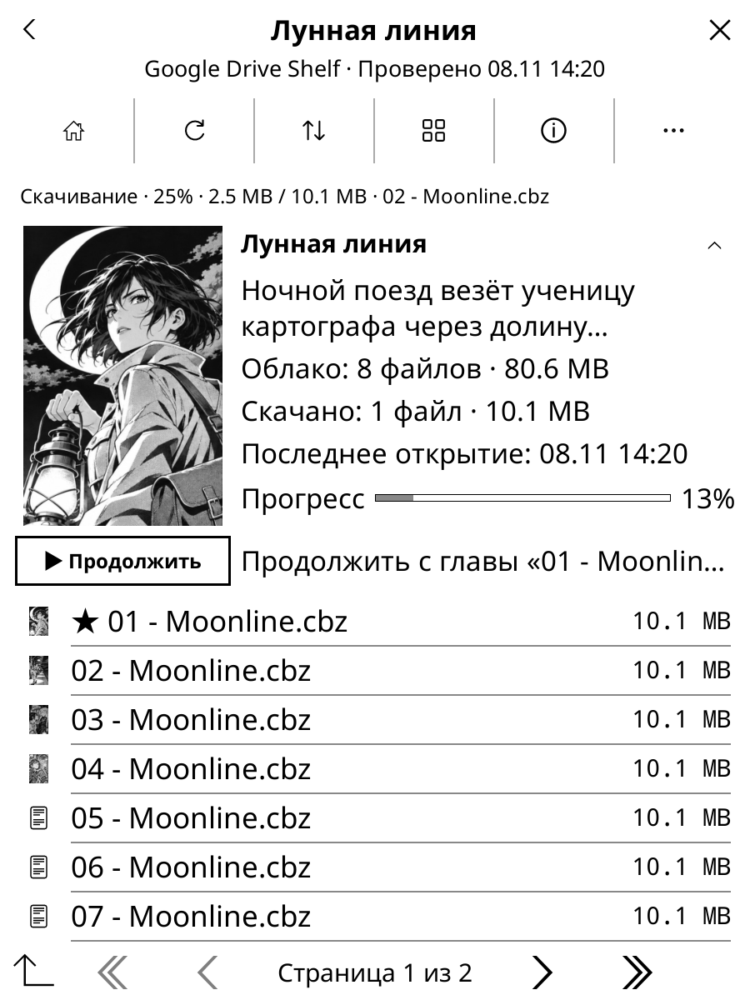
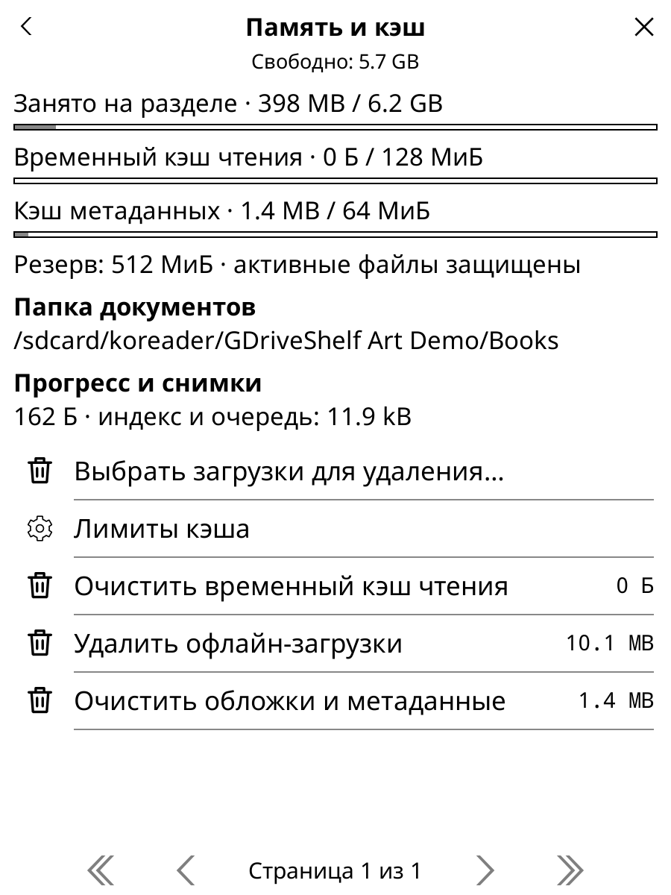
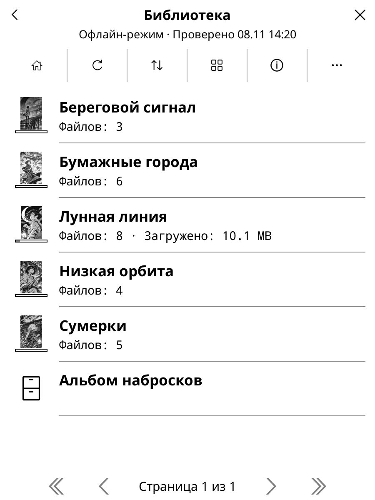
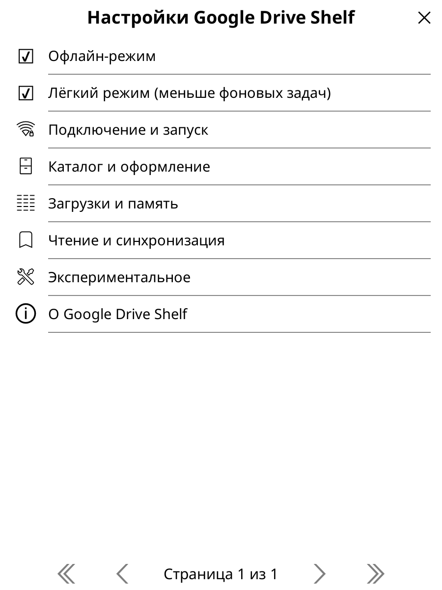
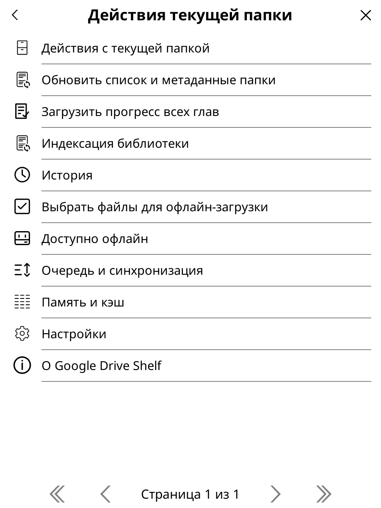
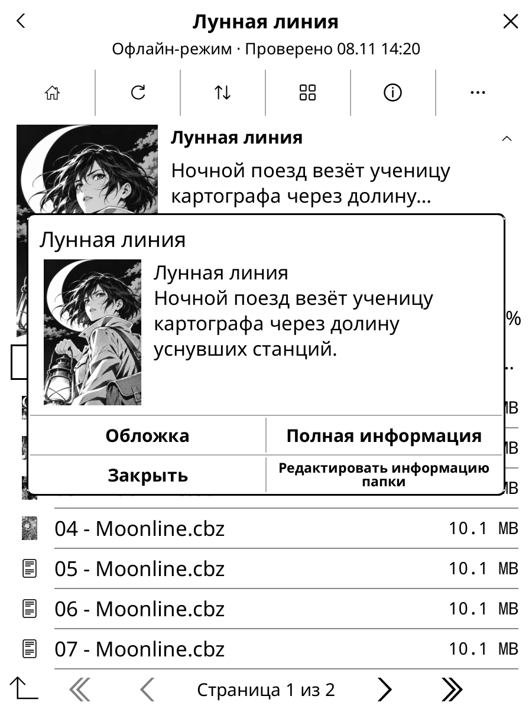
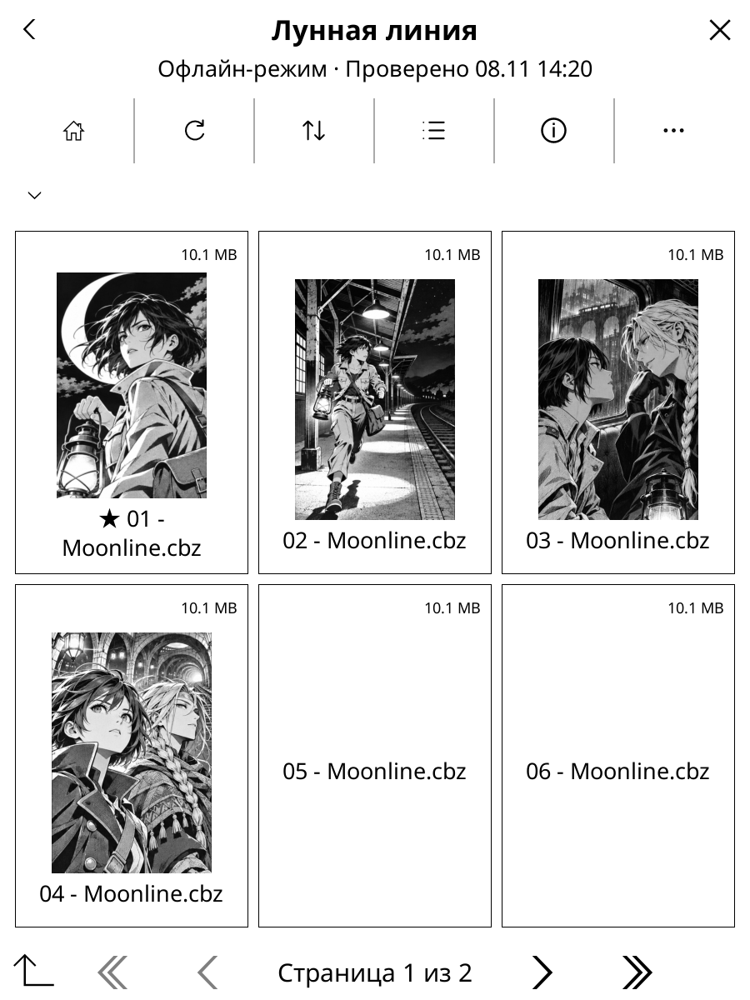
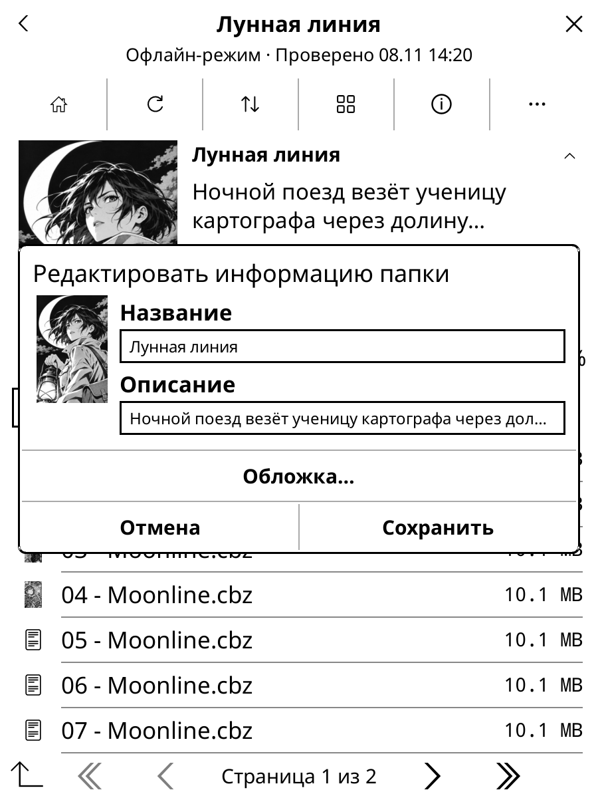
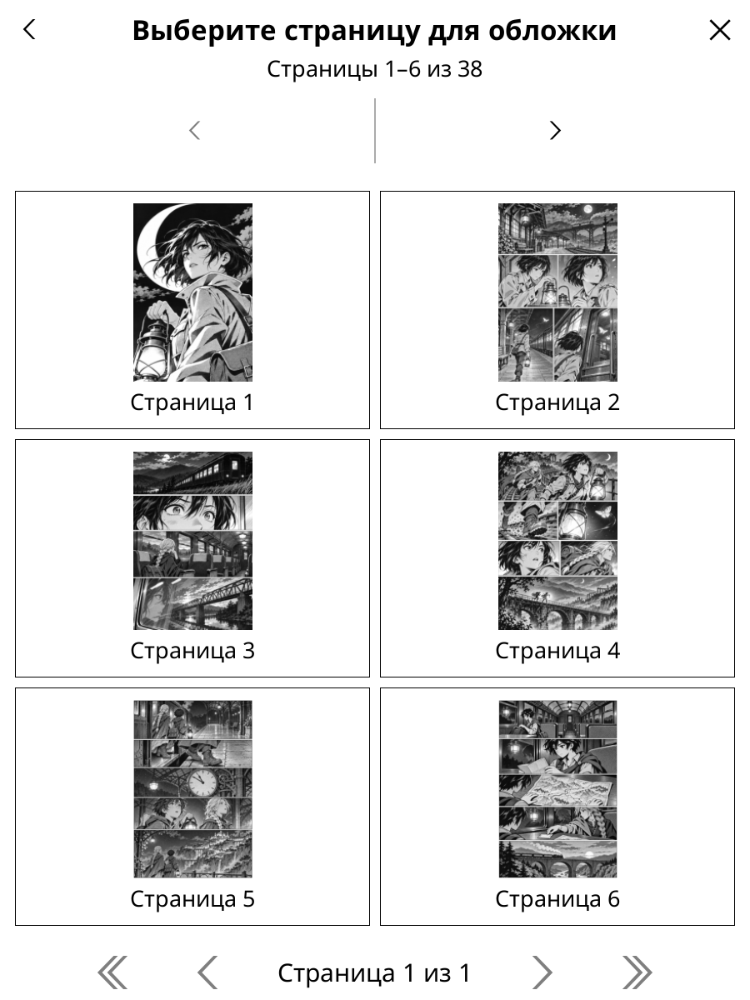

[English](README.md)

<h1 align="center">Google Drive Shelf</h1>

<strong>Библиотека Google Drive — внутри KOReader.</strong> Книги и комиксы, офлайн-загрузки и синхронизация нативного прогресса.

<a href="../../releases">Скачать</a> · <a href="docs/authentication.ru.md">Подключить Google Drive</a> · <a href="../../issues">Сообщить об ошибке</a>

Неофициальный плагин для KOReader. Документ скачивается целиком и открывается штатным читателем: работают привычные режимы чтения, масштабирование, обрезка и действия в конце документа. Интерфейс на русском и английском следует языку KOReader.

| Библиотека | Папка манги | Память и кэш |
| :---: | :---: | :---: |
|  |  |  |

## Начало работы

1. Скачайте `gdriveshelf.koplugin-<версия>.zip` со [страницы релизов](../../releases).
2. Скопируйте папку `gdriveshelf.koplugin` в `koreader/plugins/` и перезапустите KOReader.
3. Первое подключение удобнее пройти на компьютере. Скачайте отдельный файл `gdriveshelf-authorize.py` из релиза и откройте [инструкцию для Windows, macOS или Linux](docs/authentication.ru.md). Графическая утилита откроет вход в браузере и предложит сохранить JSON. В инструкции есть варианты для терминала и для Android через Termux.
4. Откройте **Google Drive Shelf** в правой вкладке меню KOReader. Выберите созданный файл `gdriveshelf-credentials.json` или введите путь к нему. На Android для переноса подойдёт папка «Загрузки». Храните JSON в приватном месте.
5. Найдите свою библиотеку. Долгим тапом по папке выберите **«Сделать домашней папкой»**. Тапните книгу или главу, чтобы начать чтение.

## Чтение и прогресс

**«Продолжить»** открывает последнюю главу или следующую неоткрытую, если предыдущая дочитана. Книги и комиксы открываются в штатном читателе KOReader с привычными режимами, масштабированием и обрезкой. Для автоперехода выберите в KOReader **«Действие в конце документа → Открыть следующий файл»**.

Облачная синхронизация включена по умолчанию. Она сохраняет нативный прогресс `.sdr` рядом с книгами на Drive. Его видят все, у кого есть доступ к папке. Плагин работает с любым штатным способом локального хранения прогресса в KOReader. Чтобы оставить прогресс на устройстве, отключите **«Чтение и синхронизация → Синхронизация прогресса (.sdr)»**.

Конфликты синхронизации и восстановление

Когда два устройства сохранили разные позиции для одной версии книги и остальной прогресс совпадает, по умолчанию выбирается более дальняя позиция. Можно предпочесть более свежую или выбирать вручную. Различия в закладках или отметке о прочтении требуют выбора в разделе **«Загрузки и синхронизация»**. **«Восстановление прогресса…»** позволяет применить облачную копию или локальный снимок при закрытой книге.

## Загрузки и офлайн

Перед поездкой сохраните нужные файлы или папки через меню долгого нажатия и включите **«Офлайн-режим»**. Загруженные книги откроются без сети, а накопленный прогресс отправится при возвращении онлайн. Для фоновых задач KOReader должен оставаться открытым.

**«В фон без открытия»** оставляет загрузку в очереди. Когда файл готов, появится действие **«Открыть»**. Тап по строке активности открывает очередь. В разделе **«Память и кэш»** команда **«Выбрать загрузки для удаления»** освобождает место по папкам или файлам и сохраняет прогресс.

Лимиты кэша, пути книг и перенос загрузок

Временный кэш по умолчанию занимает до 3072 МиБ, метаданные — до 256 МиБ. Офлайн-загрузки хранятся до ручного удаления. Плагин оставляет 512 МиБ свободного места и защищает открытые документы. Для предзагрузки должно хватать места на текущую и следующие главы.

Книги хранятся по читаемым путям вроде `Books/Название серии/01.cbz`. При совпадении имён добавляется короткий идентификатор. Сохранение офлайн оставляет путь прежним. Его корень можно сменить через **«Загрузки и память → Папка документов»**. Перенос можно отменить, исходные файлы прогресса сохраняются для восстановления. Архивы из версий 0.1.4 и ниже потребуется скачать заново. Снимки прогресса и ожидающие отправки изменения сохраняются.

## Галерея скриншотов

| Список папок | Настройки |
| --- | --- |
|  |  |

| Действия папки | Информация о документе |
| --- | --- |
|  |  |

| Плитки глав | Редактор обложки | Выбор страницы |
| --- | --- | --- |
|  |  |  |

На скриншотах показана вымышленная библиотека с иллюстрациями манги, сгенерированными для демонстрации.

## Настройки и помощь

- **«Каталог и оформление»** настраивает список, плитки, сортировку и шапку манги. Долгим тапом можно закрепить папку или изменить название, описание и обложку. **«Тип содержимого»** позволяет, например, показывать PDF как комиксы.
- **«Подключение и запуск»** показывает текущий вариант запуска. Чтобы открывать плагин при старте, выберите его в меню KOReader **«Начинать с»**. В разделе **«Общие»** редактора жестов доступны переход домой, история и папка текущей книги.
- **«Лёгкий режим»** сокращает автоматические проверки каталога, превью и прогресса. Для свежих данных можно обновить папку вручную. В разделе **«Чтение и синхронизация»** настраивается предзагрузка: по умолчанию одна следующая глава в обычном режиме и ноль в лёгком.

Обложки, индексация и экспериментальные функции

Плагин использует `cover.jpg`, `cover.png`, `cover.webp`, `index.json` из Kotatsu Redo и `series.json` из Mylar или Komga. Пользовательские правки хранятся в отдельном `gdriveshelf.json` и файлах обложек. Если у папки нет своей обложки, можно использовать превью скачанной главы. Для выбора страницы из CBR сначала скачайте том.

Рекурсивная индексация домашней папки включается отдельно. После первого обхода плагин использует [журнал изменений Drive](https://developers.google.com/workspace/drive/api/guides/manage-changes). **«Переиндексировать библиотеку»** запускает повторный обход, который можно продолжить с контрольной точки. Содержимое `.sdr` не сканируется.

Быстрый предпросмотр CBZ и удалённые миниатюры включаются отдельно. Они читают ограниченные диапазоны ZIP32 и не меняют прогресс. Сеанс быстрого просмотра получает не более 32 МиБ и всегда меньше полного архива.

Диагностика и совместимость

В разделе **«Загрузки и синхронизация»** видны очередь, повторные попытки и конфликты. Если требуется повторный вход, см. [руководство по подключению](docs/authentication.ru.md#обновление-и-отзыв-доступа). Для отчёта об ошибке журнал можно включить и экспортировать через **«Подключение и запуск → Диагностика»**. По умолчанию он выключен и не содержит имён файлов, путей и данных авторизации.

Плагин ориентирован на API KOReader 2026.07. Результаты проверок macOS и Android приведены в [руководстве по проверке](docs/validation.md). В [сообщении об ошибке](../../issues) укажите версию KOReader и шаги воспроизведения.

Обновление через AppStore

Добавьте `https://github.com/mewforest/gdriveshelf.koplugin` в [AppStore](https://github.com/omer-faruq/appstore.koplugin). Если плагин установлен вручную, один раз выберите **Match repository**. Установите релизный файл `gdriveshelf.koplugin-<версия>.zip` и перезапустите KOReader. Настройки, авторизация и прогресс сохранятся.

Разработка и сборка

В каталоге исходников запустите `make test` или `make package VERSION=0.1.0`. CI выпускает ZIP с папкой плагина, отдельную утилиту авторизации и их контрольные суммы SHA-256.

## Лицензия

Код распространяется по [MIT](LICENSE). Список сертификатов Mozilla — по [MPL 2.0](gdriveshelf.koplugin/CA-BUNDLE.md).
