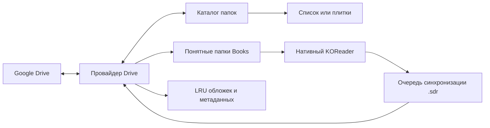

[English](README.md)

<p align="center"></p>
<h1 align="center">Google Drive Shelf</h1>
<p align="center"><strong>Библиотека Google Drive — внутри KOReader.</strong><br>Книги и комиксы, офлайн-загрузки и синхронизация нативного прогресса.</p>
<p align="center"><a href="../../releases">Скачать</a> · <a href="docs/authentication.ru.md">Подключить Google Drive</a> · <a href="../../issues">Сообщить об ошибке</a></p>

Неофициальный плагин для KOReader. Документ скачивается целиком и открывается штатным читателем: работают привычные режимы чтения, масштабирование, обрезка и действия в конце документа. Интерфейс на русском и английском следует языку KOReader.

## Начало работы

1. Скачайте **`gdriveshelf.koplugin-<версия>.zip`** из [релизов](../../releases).
2. Скопируйте папку **`gdriveshelf.koplugin`** в `koreader/plugins/` и перезапустите KOReader.
3. Пройдите [авторизацию](docs/authentication.ru.md) и выберите полученный JSON на экране подключения плагина. На Android подойдёт папка «Загрузки».
4. Найдите свою библиотеку и долгим тапом по папке выберите **«Сделать домашней папкой»**.
5. Тапните документ для скачивания и чтения. Отдельные файлы, несколько выбранных файлов или целые папки можно сохранить офлайн.

Установочный ZIP содержит только папку плагина. Отдельный файл **`gdriveshelf-authorize.py`** из того же релиза запускается на компьютере с Python 3 и вашим OAuth-клиентом Google типа **Desktop app**:

```sh
python3 gdriveshelf-authorize.py --client /путь/client.json --output /путь/gdriveshelf-credentials.json
```

Импортируйте **полученный файл авторизации**, а не JSON клиента из Google Cloud. В нём находятся приватные токены: не публикуйте его и не прикладывайте к сообщениям об ошибках.

## Быстрый доступ и каталог

**Google Drive Shelf** открывается напрямую из правой вкладки меню KOReader — в проводнике и читателе. Плагин можно выбрать в **«Начинать с»**. В редакторе жестов, раздел **«Общие»**, доступны домашняя папка, история плагина и папка текущего документа.

Панель папки разделяет переход наверх, домашнюю папку, обновление, сортировку, вид и действия. Сортировка папок и файлов настраивается отдельно и сохраняется. Закреплённые в начале папки идут первыми; за ними по настройке располагаются известные папки. Закрепление в списке **не означает скачивание офлайн**.

| Каталог | Плитки папок |
| --- | --- |
| Папки с сохранённой информацией | Карточки с обложками или названиями по центру |
| Настройки | Память |
| Категории настроек | Пулы кэша и занятое место |

Долгий тап открывает действия файла или папки. Режим выбора позволяет скачать несколько файлов сразу. У папки показываются известное количество документов, загруженный размер и приблизительная полоска открытых глав. Неизвестное количество не превращается в ноль: наличие `.sdr` означает, что документ открывался, а не обязательно был дочитан.

| Действия папки | Информация о документе |
| --- | --- |
| Действия папки и офлайн-загрузки | Обложка и описание |

История комиксов группируется по папкам; обычные книги остаются отдельными записями. CBZ/CBR/CB7 распознаются как комиксы, остальные поддерживаемые форматы — как книги. **«Тип содержимого»** папки позволяет изменить это, например для PDF-комиксов. История сохраняется после вытеснения архивов.

## Загрузки и офлайн

При скачивании видны название, полученные байты и стадия проверки. **«Отмена»** прекращает открытие; **«В фоне»** продолжает загрузку без последующего автоматического открытия. Такое же уведомление появляется, если следующая глава ещё скачивается в конце документа.

Перед поездкой сохраните нужные папки и включите **«Офлайн-режим»**. Загруженные файлы открываются без запроса к серверу. После возвращения онлайн накопленный прогресс отправляется на Drive. Для фоновых задач KOReader должен оставаться запущенным.

| Пул | Лимит по умолчанию | Удаление |
| --- | --- | --- |
| Временный кэш чтения | 3072 МиБ | Автоматически, LRU |
| Офлайн-загрузки | Без отдельного лимита | Вручную |
| Обложки, списки и миниатюры | 256 МиБ | Автоматически, LRU |

Плагин оставляет **512 МиБ свободного места** и защищает открытые документы. Для предзагрузки временный кэш должен вмещать открытую и следующую главы одновременно. Удаление архивов сохраняет метаданные чтения, снимки и очередь синхронизации.

Документы лежат в понятной структуре: **`Books/Название папки/01.cbz`**. При совпадениях или недопустимых именах добавляется короткий идентификатор. Сохранение офлайн не меняет путь. Другую папку можно выбрать в **«Загрузки и память»**; перенос поддерживает отмену и журнал восстановления. Исходные `.sdr` остаются как резервные копии. Версии до 0.1.4 включительно использовали другую структуру архивов: эти пути не переносятся и не используются повторно; документы нужно скачать заново. Снимки прогресса и pending sync сохраняются.

## Обложки и индексация

Соседние `cover.jpg`, `index.json` Kotatsu Redo и `series.json` Mylar/Komga могут предоставить обложку, название, автора и описание. Загрузка обложек и описательных метаданных включается отдельно. Служебные файлы и папки `.sdr` по умолчанию скрыты.

Необязательная **индексация домашней папки** проверяет её непосредственные подпапки, без скачивания документов или содержимого удалённых `.sdr`. Новые папки проверяются сразу, известные по умолчанию — раз в сутки. Интервал меняется, периодическую проверку можно отключить. Кнопка обновления доступна прямо на панели папки. Изменение версии исходного файла инвалидирует его сохранённую информацию.



## Прогресс чтения

Штатное **«Действие в конце документа → Открыть следующий файл»** переходит к следующему документу внутри текущей папки; режим **«Спросить»** сохраняет диалог KOReader. Предзагрузка комиксов следует выбранному порядку файлов. Для следующей обычной книги предусмотрен отдельный выключенный переключатель.

Синхронизация записывает нативную `<книга>.sdr/metadata.<расширение>.lua` рядом с документом на Drive. Локально KOReader может хранить данные рядом с книгой, централизованно или по хешу: **локальная соседняя `.sdr` не обязательна**. Другой KOReader сможет подхватить облачные данные, когда книга и её `.sdr` доступны как обычные локальные файлы. Эти `.sdr` видят все, у кого есть доступ к папке Drive. При выключенной синхронизации чтение остаётся локальным.

Скачанный Lua разбирается как данные и не исполняется. При конфликте обе версии сохраняются для явного выбора в **«Загрузки и синхронизация»**. Облачная позиция не меняет страницу уже открытого документа неожиданно. Неоднозначные одинаковые имена или изменившаяся версия книги могут потребовать ручного решения.

## Необязательные эксперименты

Все экспериментальные возможности по умолчанию **выключены**:

- **Расширенная шапка информации** — сворачиваемая обложка и краткое описание над списком файлов.
- **Миниатюры глав** — плитки глав и ручное рекурсивное сканирование обложек. Отдельный переключатель разрешает автоматическое сканирование домашней библиотеки.
- Для удалённого превью читаются ограниченные диапазоны ZIP32 и первая картинка. Поддерживаются Store и Deflate; ZIP64, шифрованные, повреждённые и слишком большие архивы пропускаются. Полный удалённый CBZ ради миниатюры не скачивается, в том числе суммой запросов. Уже скачанный архив читается локально.

Лимиты на превью: **1 МиБ оглавления ZIP, 8 МиБ полученных данных, 16 МиБ распакованной картинки и 16 мегапикселей**. Миниатюры входят в LRU метаданных. Сканирование исключает `.sdr`, поддерживает отмену и уступает чтению. При отсутствии общей обложки может использоваться первая страница первой главы. Кэш миниатюр остаётся на устройстве.

## Совместимость и разработка

Ориентир — **API KOReader 2026.07**. Проверено в официальных сборках macOS ARM64 и Android ARM64 на эмуляторе Android 11. Обновление физического E-Ink экрана зависит от устройства. Методика и результаты — в [руководстве по проверке](docs/validation.md).

Экспорт Google Docs/Sheets/Slides и отдельная Android-служба фоновых загрузок не входят в плагин. Проверка HTTPS включена; Mozilla CA bundle поставляется в комплекте.

```sh
make test
make package VERSION=0.1.5
```

CI проверяет pull request и автоматически выпускает архив только с папкой плагина и SHA-256 при пуше в `master`. Для [сообщения об ошибке](../../issues) приложите версию KOReader и шаги воспроизведения, удалив данные авторизации.

## Лицензия

Исходный код: [MIT](LICENSE). Mozilla CA bundle: [MPL 2.0](gdriveshelf.koplugin/CA-BUNDLE.md). Иллюстрации на скриншотах принадлежат их правообладателям.
