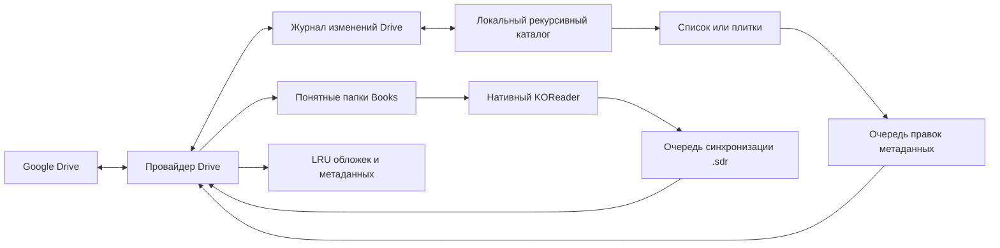

[English](README.md)

<p align="center"></p>
<h1 align="center">Google Drive Shelf</h1>
<p align="center"><strong>Библиотека Google Drive — внутри KOReader.</strong><br>Книги и комиксы, офлайн-загрузки и синхронизация нативного прогресса.</p>
<p align="center"><a href="../../releases">Скачать</a> · <a href="docs/authentication.ru.md">Подключить Google Drive</a> · <a href="../../issues">Сообщить об ошибке</a></p>

Неофициальный плагин для KOReader. Документ скачивается целиком и открывается штатным читателем: работают привычные режимы чтения, масштабирование, обрезка и действия в конце документа. Интерфейс на русском и английском следует языку KOReader.

| Библиотека | Папка манги и фоновая загрузка | Память и кэш |
| :---: | :---: | :---: |
| Библиотека манги в три столбца | Обложка, кнопка продолжения, главы и фоновая загрузка | Память и кэш со шкалами и командами очистки |

## Начало работы

1. Скачайте **`gdriveshelf.koplugin-<версия>.zip`** из [релизов](../../releases).
2. Скопируйте папку **`gdriveshelf.koplugin`** в `koreader/plugins/` и перезапустите KOReader.
3. Пройдите [авторизацию](docs/authentication.ru.md) и выберите полученный JSON на экране подключения плагина. На Android подойдёт папка «Загрузки».
4. Найдите свою библиотеку и долгим тапом по папке выберите **«Сделать домашней папкой»**.
5. Тапните документ для скачивания и чтения. Отдельные файлы, несколько выбранных файлов или целые папки можно сохранить офлайн.

Установочный ZIP содержит только папку плагина. Отдельный файл **`gdriveshelf-authorize.py`** из того же релиза запускается на компьютере с Python 3 и вашим OAuth-клиентом Google типа **Desktop app**:

```sh
python3 gdriveshelf-authorize.py --client /путь/client.json --output /путь/gdriveshelf-credentials.json
```

Импортируйте **полученный файл авторизации**, а не JSON клиента из Google Cloud. В нём находятся приватные токены: не публикуйте его и не прикладывайте к сообщениям об ошибках.

## Обновления через AppStore

Когда репозиторий станет публичным, [AppStore](https://github.com/omer-faruq/appstore.koplugin) сможет устанавливать и обновлять плагин прямо на читалке. Добавьте репозиторий `mewforest/gdriveshelf.koplugin` по ссылке. Уже установленный вручную плагин один раз свяжите с репозиторием через **Match repository**. Выбирайте релизный **`gdriveshelf.koplugin-<версия>.zip`**, затем перезапускайте KOReader. Для стабильных обновлений не используйте архивы исходников GitHub или ветку разработки.

Имя папки остаётся `gdriveshelf.koplugin`. Авторизация, настройки, пути документов, прогресс, история и ожидающие отправки изменения хранятся вне установленного кода и сохраняются при обновлении. Повторная Google-авторизация не нужна. Публичное обнаружение и скачивание станут доступны после изменения видимости владельцем. Плагин сам не меняет видимость репозитория.

## Быстрый доступ и каталог

**Google Drive Shelf** открывается напрямую из правой вкладки меню KOReader — в проводнике и читателе. Плагин можно выбрать в **«Начинать с»**. В редакторе жестов, раздел **«Общие»**, доступны домашняя папка, история плагина и папка текущего документа.

Панель папки разделяет переход наверх, домашнюю папку, обновление, сортировку, вид и действия. Сортировка папок и файлов настраивается отдельно и сохраняется. Закреплённые в начале папки идут первыми; за ними по настройке располагаются известные папки. Закрепление в списке **не означает скачивание офлайн**.

На новой установке папки открываются сеткой **3×2**, а главы — списком. Для глав можно включить плитки и задать отдельную сетку. Сохранённые настройки вида имеют приоритет.

| Список папок | Настройки |
| --- | --- |
| Папки с сохранённой информацией | Категории настроек |

Долгий тап открывает действия файла или папки. Режим выбора позволяет скачать несколько файлов сразу. В левом верхнем углу карточки видны количество и размер скачанных документов. Справа выводятся известные общие количество и размер. Размер сетки папок и документов настраивается отдельно. У контейнера без документов показывается число подпапок. Проверенные пустые папки скрыты по умолчанию, неизвестные остаются видимыми. Приблизительная полоска показывает открытые главы. Неизвестное количество не превращается в ноль: наличие `.sdr` означает, что документ открывался, а не обязательно был дочитан.

| Действия папки | Информация о документе |
| --- | --- |
| Действия папки и офлайн-загрузки | Обложка и описание |

История комиксов группируется по папкам; обычные книги остаются отдельными записями. CBZ/CBR/CB7 распознаются как комиксы, остальные поддерживаемые форматы — как книги. **«Тип содержимого»** папки позволяет изменить это, например для PDF-комиксов. История сохраняется после вытеснения архивов.

## Загрузки и офлайн

При открытии несохранённого документа появляется окно с названием, полученными байтами и стадией проверки. **«Отмена»** останавливает запрос. **«В фон без открытия»** переносит запрос в строку активности каталога. Когда файл готов, его можно открыть из уведомления или очереди. В окне загрузки видно прошедшее время и, после нескольких замеров, оценку остатка. Такое же уведомление появляется, если следующая глава ещё скачивается в конце документа.

Перед поездкой сохраните нужные папки и включите **«Офлайн-режим»**. Загруженные файлы открываются без запроса к серверу. После возвращения онлайн накопленный прогресс отправляется на Drive. Для фоновых задач KOReader должен оставаться запущенным.

| Пул | Лимит по умолчанию | Удаление |
| --- | --- | --- |
| Временный кэш чтения | 3072 МиБ | Автоматически, LRU |
| Офлайн-загрузки | Без отдельного лимита | Вручную |
| Обложки, списки и миниатюры | 256 МиБ | Автоматически, LRU |

Плагин оставляет **512 МиБ свободного места** и защищает открытые документы. Для предзагрузки временный кэш должен вмещать открытую и следующую главы одновременно. Команда «Выбрать загрузки для удаления» показывает папки по размеру и позволяет убрать временные и офлайн-архивы выборочно. Удаление архивов сохраняет метаданные чтения, снимки и очередь синхронизации.

Документы лежат в понятной структуре: **`Books/Название папки/01.cbz`**. При совпадениях или недопустимых именах добавляется короткий идентификатор. Сохранение офлайн не меняет путь. Другую папку можно выбрать в **«Загрузки и память»**; перенос поддерживает отмену и журнал восстановления. Исходные `.sdr` остаются как резервные копии. Версии до 0.1.4 включительно использовали другую структуру архивов: эти пути не переносятся и не используются повторно; документы нужно скачать заново. Снимки прогресса и pending sync сохраняются.

## Лёгкий режим

**«Лёгкий режим»** доступен в настройках плагина. Он отключает автоматические проверки индекса, создание миниатюр и подробные запросы прогресса по страницам списка. Предзагрузка по умолчанию выключена. В разделе «Чтение и синхронизация» можно отдельно задать количество глав и порог. При открытии папки её сохранённый список используется до 15 минут. Кнопка обновления сразу проверяет папку и отправляет ожидающий прогресс. Прогресс также отправляется при возвращении в каталог после чтения. Под названием папки видно время последней проверки. Ручные загрузки, превью и индексация доступны.

## Обложки и индексация

Соседние `cover.jpg`, `cover.png` или `cover.webp`, `index.json` Kotatsu Redo и `series.json` Mylar/Komga могут предоставить обложку, название, автора и описание. Загрузка обложек и описательных метаданных включается отдельно. Служебные файлы и папки `.sdr` по умолчанию скрыты.

Шапка папки с комиксами показывает обложку, описание, количество и размер документов. Её можно временно свернуть. **«Продолжить чтение»** опирается на историю или последнюю главу с подходящей нативной папкой прогресса. Если глава дочитана, кнопка открывает следующую ещё не начатую. Долгий тап по главе позволяет изменить отметку о прочтении. Скачанные CBZ, EPUB, PDF и поддерживаемые CBR получают локальные обложки. Обработка RAR может занять больше времени, особенно для solid-архивов. Для выбора обложки из CBR сначала скачайте том. Если собственной обложки папки нет, используется первое доступное локальное превью в естественном порядке имён файлов. Извлечение обложек CB7 текущий runtime не гарантирует.

**Редактировать информацию папки** позволяет изменить название, описание и обложку. Правки сразу видны локально, сохраняются в устойчивой офлайн-очереди и отправляются в отдельный версионированный `gdriveshelf.json` и отдельные файлы обложек. Исходные `index.json`, `series.json`, `cover.jpg` и SDR не меняются. Конфликт сохраняет обе версии для выбора в «Загрузки и синхронизация». В редакторе видно текущую обложку. Её можно скрыть, вернуть автообложку, выбрать изображение или страницу скачанного тома. Быстрое действие берёт первую страницу первой главы, в том числе через ограниченный Range-запрос к удалённому CBZ.

| Плитки глав | Редактор обложки | Выбор страницы |
| --- | --- | --- |
| Плитки глав с локальной обложкой | Редактор с текущей обложкой | Выбор страницы для обложки |

**Рекурсивная индексация домашней папки** выключена по умолчанию и требует явного подтверждения. Первый обход получает дерево без скачивания документов и содержимого SDR. Затем обычное обновление использует [журнал изменений Drive](https://developers.google.com/workspace/drive/api/guides/manage-changes): проверка при входе в каталог и выходе из сна не чаще раза в 30 секунд, ручное обновление — сразу. **«Переиндексировать библиотеку»** открывает экран хода проверки. Индексацию можно приостановить и продолжить с контрольной точки или оставить в фоне. Общий облачный файл дерева не создаётся. Обложки и описания загружаются отдельными задачами низкого приоритета.



## Прогресс чтения

Штатное **«Действие в конце документа → Открыть следующий файл»** переходит к следующему документу внутри текущей папки; режим **«Спросить»** сохраняет диалог KOReader. Предзагрузка комиксов следует выбранному порядку файлов. Для следующей обычной книги предусмотрен отдельный выключенный переключатель.

Синхронизация записывает нативную `<книга>.sdr/metadata.<расширение>.lua` рядом с документом на Drive. Локально KOReader может хранить данные рядом с книгой, централизованно или по хешу: **локальная соседняя `.sdr` не обязательна**. Другой KOReader сможет подхватить облачные данные, когда книга и её `.sdr` доступны как обычные локальные файлы. Эти `.sdr` видят все, у кого есть доступ к папке Drive. При выключенной синхронизации чтение остаётся локальным.

Скачанный Lua разбирается как данные и не исполняется. При конфликте обе версии сохраняются. Если подтверждена та же версия книги и различается только позиция, по умолчанию применяется дальняя. В настройках также доступны более свежая позиция и ручной выбор. Экран сравнения показывает страницу, процент, статус и дату, когда она известна. Облачная позиция не меняет страницу уже открытого документа неожиданно. Неоднозначные одинаковые имена или изменившаяся версия книги могут потребовать ручного решения.

## Необязательные эксперименты

Все экспериментальные возможности по умолчанию **выключены**:

- **«Быстрый предпросмотр CBZ»** открывает изображения через меню долгого нажатия. Сетевой сеанс ограничен 32 МиБ и объёмом меньше полного архива.
- **Миниатюры глав** — удалённые превью CBZ и ручное рекурсивное сканирование обложек. Плитки файлов и готовые локальные изображения доступны и без этого эксперимента. Отдельный переключатель разрешает автоматическое сканирование домашней библиотеки.
- Для удалённого превью читаются ограниченные диапазоны ZIP32 и первая картинка. Поддерживаются Store и Deflate; ZIP64, шифрованные, повреждённые и слишком большие архивы пропускаются. Полный удалённый CBZ ради миниатюры не скачивается, в том числе суммой запросов. Уже скачанный архив читается локально.

Лимиты на превью: **1 МиБ оглавления ZIP, 8 МиБ полученных данных, 16 МиБ распакованной картинки и 16 мегапикселей**. Миниатюры входят в LRU метаданных. Сканирование исключает `.sdr`, поддерживает отмену и уступает чтению. При отсутствии общей обложки может использоваться первая страница первой главы. Кэш миниатюр остаётся на устройстве.

## Загрузка и диагностика

Компактная строка фоновой загрузки в каталоге открывает очередь **«Загрузки и синхронизация»**. Предзагрузка поддерживает 0–3 следующих файла; скачивания идут последовательно. «В фоне» продолжает загрузку, отменяя автоматическое открытие.

«Офлайн-режим», «Ожидание повторной попытки», «Ожидание выхода из сна» и «Требуется авторизация» обозначают разные состояния. Временные сетевые ошибки сохраняют очередь; повреждённое превью или ошибка локального файла не блокируют остальные запросы. **Восстановление прогресса…** применяет загруженную облачную копию или последний локальный снимок только при закрытом документе.

**Подключение и запуск → Диагностика** включает ограниченный журнал операций, кодов ошибок и переходов очереди. По умолчанию он выключен. Журналы лежат в папке данных `gdriveshelf/logs`, вне кода плагина, и занимают не более **2 МиБ** суммарно. Имена, ID, пути, URL, токены и содержимое ответов не записываются. В этом же меню можно экспортировать или очистить журнал.

## Совместимость и разработка

Ориентир — **API KOReader 2026.07**. Проверено в официальных сборках macOS ARM64 и Android ARM64 на эмуляторе Android 11. Обновление физического E-Ink экрана зависит от устройства. Методика и результаты — в [руководстве по проверке](docs/validation.md).

Экспорт Google Docs/Sheets/Slides и отдельная Android-служба фоновых загрузок не входят в плагин. Проверка HTTPS включена; Mozilla CA bundle поставляется в комплекте.

```sh
make test
make package VERSION=0.1.7
```

CI проверяет pull request и автоматически выпускает архив только с папкой плагина и SHA-256 при пуше в `master`. Для [сообщения об ошибке](../../issues) приложите версию KOReader и шаги воспроизведения, удалив данные авторизации.

## Лицензия

Исходный код: [MIT](LICENSE). Mozilla CA bundle: [MPL 2.0](gdriveshelf.koplugin/CA-BUNDLE.md). Иллюстрации на скриншотах принадлежат их правообладателям.
