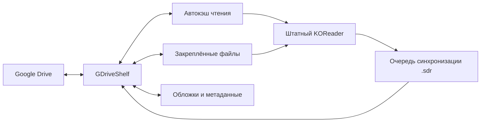

[English](README.md)

<p align="center">
  
</p>
<h1 align="center">GDriveShelf</h1>
<p align="center"><strong>Ваша библиотека Google Drive — в KOReader.</strong><br>Скачивайте главы целиком, читайте привычным способом и берите библиотеку с собой офлайн.</p>

GDriveShelf — плагин KOReader для просмотра и чтения книг и комиксов из Google Drive. Он скачивает файл целиком и открывает его штатным движком KOReader: масштабирование, обрезка полей, развороты и режимы чтения работают как у локальной книги.

[Скачать релиз](../../releases) · [Подключить Google Drive](docs/authentication.ru.md) · [Сообщить о проблеме](../../issues)

## Быстрый старт

1. Скачайте ZIP из [Releases](../../releases).
2. Скопируйте `gdriveshelf.koplugin` в `koreader/plugins/` и перезапустите KOReader.
3. Создайте JSON авторизации по [инструкции подключения](docs/authentication.ru.md) и откройте **GDriveShelf → Выбрать JSON авторизации**.
4. Откройте папку библиотеки и сделайте её домашней через действия текущей папки.
5. Тап по главе скачивает и открывает её. Долгое нажатие на файл или папку открывает действия, в том числе загрузку для офлайн-чтения.

Для авторизации нужны Python 3, собственный Google OAuth-клиент типа **Desktop app** и системный браузер:

```sh
python3 tools/authorize.py --client /path/to/client.json --output /path/to/gdriveshelf-credentials.json
```

В установочном ZIP находится только `gdriveshelf.koplugin/`. Утилиту [gdriveshelf-authorize.py](https://github.com/mewforest/gdriveshelf.koplugin/releases/latest/download/gdriveshelf-authorize.py) скачайте отдельно из того же релиза и используйте это имя вместо `tools/authorize.py`. Пароль вводится только на сайте Google. Полученный JSON содержит секретные данные: не прикладывайте его к обращениям и не добавляйте в Git.

<details>
<summary>Экран первого подключения</summary>

Первое подключение: выбор JSON, ввод пути и справка

</details>

## Привычное чтение

| Библиотека и прогресс | Информация о библиотеке |
| :---: | :---: |
| Список глав Google Drive со статусом загрузки и чтения | Название, автор, теги, описание и обложка |
| **Управление хранилищем** | **Настройки** |
| Использование памяти и отдельная очистка трёх пулов | Настройки GDriveShelf в KOReader |
| **Список тайтлов** | **Библиотека и действия** |
| Папки тайтлов с обложкой, названием и автором из кэша | Навигация, последний документ, действия с папкой и сортировка тайтлов |

## Возможности

- Просмотр папок Drive, естественная сортировка глав и выбор домашней папки.
- Обложки, названия и авторы в списке тайтлов. Отдельная сортировка по имени, последнему открытию и дате добавления; настройки сохраняются между запусками.
- Возврат к последнему документу через «Библиотека и действия», со штатным прогрессом и предзагрузкой следующих глав при доступной сети.
- Чтение загруженных файлов офлайн и закрепление отдельных файлов или целых папок.
- Предзагрузка следующих глав в пределах папки текущего тайтла.
- Обложки и описания из соседних `cover.jpg`, Kotatsu Redo `index.json` и Mylar/Komga `series.json`.
- Синхронизация нативных данных чтения KOReader в `.sdr` рядом с книгами на Drive, в том числе после офлайн-чтения.
- Просмотр конфликтов синхронизации и выбор нужной версии.
- Английский и русский интерфейс по языку KOReader; для остальных языков используется английский.



## Офлайн и хранилище

| Пул | Лимит по умолчанию | Очистка |
| --- | --- | --- |
| Автокэш чтения | 3072 МиБ | Автоматически, по давности использования |
| Закреплённые файлы и папки | Без отдельного лимита | Вручную |
| Обложки, списки и удалённые метаданные | 256 МиБ | Автоматически, по давности использования |

GDriveShelf оставляет **512 МиБ свободного места** на разделе и защищает открытую книгу. Очистка архивов сохраняет локальные `.sdr`, снимки прогресса и очередь синхронизации.

Перед поездкой загрузите нужные папки и включите **Офлайн: запретить сеть** в настройках. Загруженные главы открываются без запроса к серверу. После возвращения онлайн накопленный прогресс может отправляться и для уже закрытых книг. Для загрузок и фоновых задач KOReader должен оставаться запущенным.

## Прогресс и совместимость

«Сортировка тайтлов» доступна в «Библиотека и действия» и настройках. Последнее открытие учитывает книги, открытые через GDriveShelf на этом устройстве. Дата добавления — дата создания папки на Drive; если она неизвестна, используется первое обнаружение папки плагином. Обложка и название появляются после загрузки метаданных папки; просмотр родительского списка не сканирует все вложенные папки.

Облачный прогресс не переносит открытую книгу на другую страницу неожиданно. Сохранённую облачную позицию можно применить явно, а конфликты разрешить в **Очередь и синхронизация**.

Папка вида `Book.sdr/metadata.cbz.lua` содержит нативные данные KOReader. Другая установка KOReader сможет использовать их, когда книга и её `.sdr` доступны как обычные локальные файлы. Доступ к Drive обеспечивает плагин; само наличие `.sdr` в облаке не даёт KOReader прямого доступа к Drive. Одинаковые имена и изменившиеся версии книг могут потребовать ручного решения.

Плагин ориентирован на **API KOReader 2026.07**. Интеграция проверена в официальной сборке macOS ARM64; испытания на физических Android-читалках остаются важными. Покрытие и порядок проверок описаны в [руководстве по проверке](docs/validation.md) на английском.

Google Docs, Sheets и Slides не экспортируются. Отдельного переключателя общих дисков и самостоятельного Android-сервиса загрузок нет. Служебные файлы скрыты по умолчанию; ссылки и удалённые изображения из метаданных автоматически не открываются. Проверка HTTPS-сертификатов включена, Mozilla CA bundle входит в пакет.

## Помощь и разработка

Для сообщения об ошибке или предложения [создайте issue](../../issues). Укажите версию KOReader, платформу, шаги воспроизведения и сообщение об ошибке или скриншот без секретных данных.

Для разработки нужны LuaJIT и Python 3:

```sh
make test
make package VERSION=0.1.0
```

Сборка проверяет синтаксис, запускает тесты и создаёт ZIP с SHA-256. Нативные проверки KOReader и необязательные проверки Drive описаны в [руководстве по проверке](docs/validation.md). Pull request приветствуются. CI проверяет pull request и публикует версионные релизы после пушей в `master`.

## Лицензия

Оригинальный код — [MIT](LICENSE). Включённый [Mozilla CA bundle](gdriveshelf.koplugin/CA-BUNDLE.md) распространяется по MPL 2.0. Изображения на скриншотах принадлежат соответствующим правообладателям и используются для демонстрации интерфейса.
