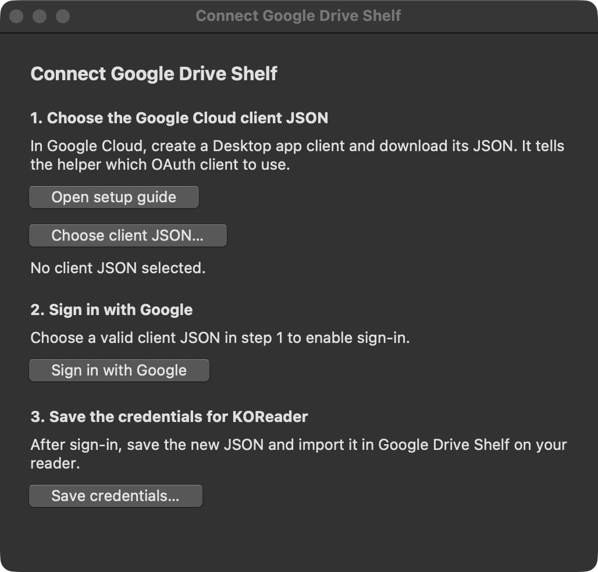
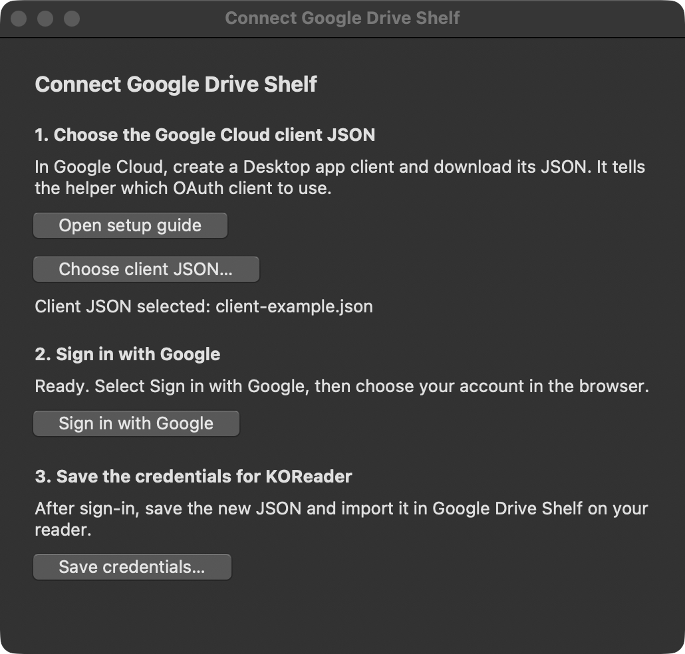
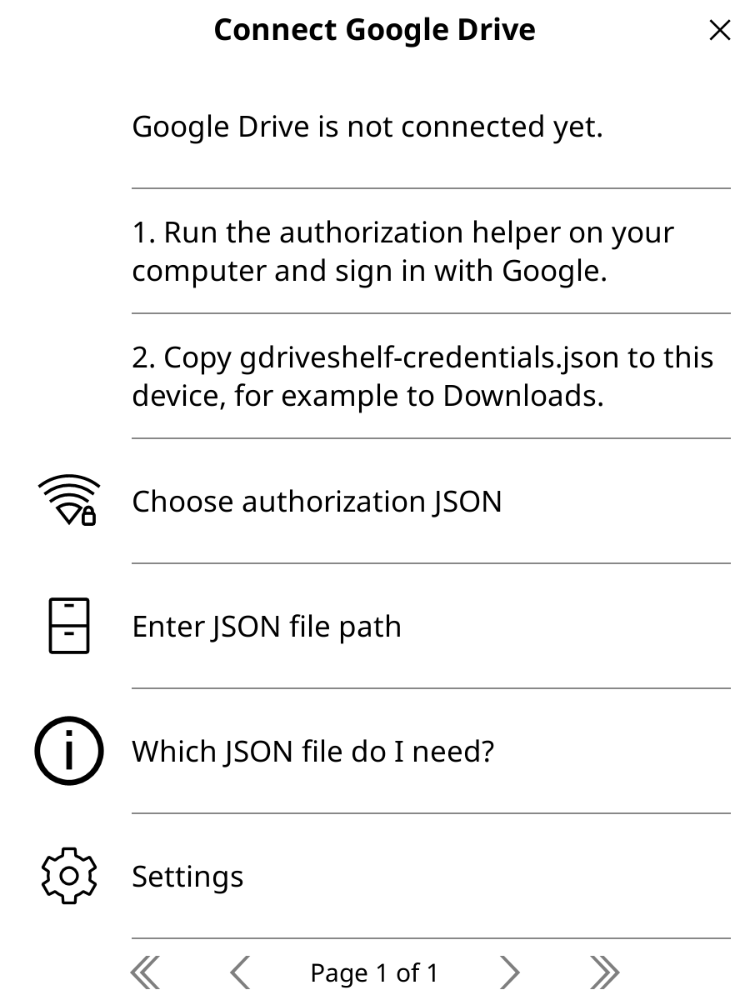

[Русская версия](authentication.ru.md) · [Back to README](../README.md)

# Connect Google Drive

GDriveShelf uses your own Google OAuth **Desktop app** client. On a computer, the graphical helper opens Google sign-in in your browser and saves a JSON file for import on your reader.

## 1. Create a Desktop app client

1. Open [Google Cloud Console](https://console.cloud.google.com/) and create or select a project.
2. Enable the **Google Drive API** for that project.
3. Configure the OAuth consent screen. If the app is in **Testing**, add the Google account you will use as a test user.
4. Create an OAuth client with application type **Desktop app** and download its client JSON.

Use the downloaded Desktop client JSON, which contains an `installed` configuration. A web application client or service-account key will not work with this helper. See Google’s [OAuth guide for desktop apps](https://developers.google.com/identity/protocols/oauth2/native-app) for the project and consent settings.

## 2. Sign in and save the credentials

Download [gdriveshelf-authorize.py](https://github.com/mewforest/gdriveshelf.koplugin/releases/latest/download/gdriveshelf-authorize.py) from the release. Open a terminal in the download folder and use the command for your system.

| System | Command |
| --- | --- |
| Windows (PowerShell) | `py -3 .\gdriveshelf-authorize.py` |
| macOS or Linux | `python3 ./gdriveshelf-authorize.py` |

On Windows, try `python` instead of `py -3` if that is how you launch Python 3. The helper uses Python’s standard Tkinter module. Some Linux distributions package Tk support separately, for example as `python3-tk` on Debian or Ubuntu.

1. Select **Choose client JSON…** and open the Desktop client JSON from Google Cloud.
2. Select **Sign in with Google**, choose your account in the system browser and review the permissions. You enter your Google password only on Google’s sign-in page.
3. Return to the helper and save `gdriveshelf-credentials.json` in a private folder.

| Choose the client JSON | Client selected, ready to sign in |
| :---: | :---: |
| <a href="screenshots/authorize-desktop-choose.png"></a> | <a href="screenshots/authorize-desktop-ready.png"></a> |

The helper requests full Google Drive access (`https://www.googleapis.com/auth/drive`) so the plugin can read an existing library and sync native `.sdr` progress beside books. This sign-in does not change any files on Drive.

<details>
<summary>Use the terminal without a graphical window</summary>

Windows (PowerShell):

```powershell
py -3 .\gdriveshelf-authorize.py --client ".\client.json" --output ".\gdriveshelf-credentials.json"
```

macOS or Linux:

```sh
python3 ./gdriveshelf-authorize.py --client "./client.json" --output "./gdriveshelf-credentials.json"
```

From a source checkout, use `tools/authorize.py` in place of the release filename. Both modes use PKCE S256 and a temporary callback on `127.0.0.1`. The browser step times out after 180 seconds. Add `--timeout 300` if you need more time. Keep the callback URL private.

</details>

<details>
<summary>Android only: authorize with Termux</summary>

This is an alternative if you have no computer. Install [Termux](https://github.com/termux/termux-app#installation) and create the same **Desktop app** OAuth client in Google Cloud. Save its downloaded JSON as `client.json` in Android’s Downloads folder. Use a regular browser for Google sign-in.

Run `termux-setup-storage`, grant storage access and return to Termux. Once `~/storage/downloads` is available, paste this block:

```sh
pkg install python curl coreutils &&
mkdir -p "$HOME/gdriveshelf-auth" &&
cd "$HOME/gdriveshelf-auth" &&
curl -fsSLO https://github.com/mewforest/gdriveshelf.koplugin/releases/latest/download/gdriveshelf-authorize.py &&
curl -fsSLO https://github.com/mewforest/gdriveshelf.koplugin/releases/latest/download/gdriveshelf-authorize.py.sha256 &&
sha256sum -c gdriveshelf-authorize.py.sha256 &&
python ./gdriveshelf-authorize.py --termux \
  --client "$HOME/storage/downloads/client.json" \
  --output "$HOME/gdriveshelf-auth/gdriveshelf-credentials.json"
```

Leave Termux running while Google opens in the browser. After a successful sign-in, copy the private output to Downloads for import in KOReader:

```sh
cp -i "$HOME/gdriveshelf-auth/gdriveshelf-credentials.json" "$HOME/storage/downloads/"
```

Delete the shared copy after import. If Android blocks direct Downloads access, use a file manager with Android’s system file picker and the **Termux** location, if available, to move the two files across. Pass the local path of the client JSON to `--client`. If the browser cannot return to the local callback, use the computer method.

</details>

## 3. Import into KOReader

1. Transfer `gdriveshelf-credentials.json` to a location KOReader can access.
2. Open **Google Drive Shelf** and select **Choose authorization JSON** on the connection screen. Import also remains available under **Settings → Connection and startup**.
3. Select the generated credentials file. Do not select the original OAuth client JSON.
4. After a successful import, remove unnecessary copies from Downloads and the transfer device.

Downloads is a suitable location; the file does not belong in the plugin folder. On Android the usual path is `/storage/emulated/0/Download/gdriveshelf-credentials.json`. The picker starts at KOReader's home folder. You can also choose **Enter JSON file path**. If KOReader cannot access the file, check its storage permission in Android settings.

The generated JSON contains the OAuth client configuration, access and refresh tokens, expiry, scope, a stable `account_id` based on Drive’s `user.permissionId`, and the account email for display. The helper saves it atomically and does not print tokens. On POSIX it sets mode `0600`. On Windows, save it in a folder private to your user account. The plugin keeps a private local copy and saves refreshed credentials there.

Do not commit either JSON file, include them in plugin archives, attach them to issues, or paste them into logs or chats. Anyone with the generated credentials may be able to access your Drive.



## Renew or revoke access

If authorization fails with `invalid_grant`, or you revoke access, rerun the helper and import a new credentials JSON. If Google does not return a refresh token, repeat consent; you may need to revoke the old grant first. Apps in Testing can receive refresh tokens with a limited lifetime under Google’s OAuth policies.

To stop access, remove the app’s permission from your [Google account connections](https://myaccount.google.com/connections). Deleting a local credentials file alone does not revoke the grant.

## HTTPS verification

The plugin validates certificate chains and hostnames before sending HTTP headers. Redirects are refused so credentials are not forwarded to another host. The included Mozilla CA bundle comes from [curl CA Extract](https://curl.se/docs/caextract.html); its provenance, checksum, and license are in [CA-BUNDLE.md](../gdriveshelf.koplugin/CA-BUNDLE.md). Certificate verification cannot be disabled in plugin settings. The Python helper uses the standard verified SSL context.

The plugin uses KOReader’s `socketutil` timeouts: 15 seconds for blocking input and 120 seconds for a transfer after the request begins. DNS resolution is outside those timeouts. API errors expose a safe code and HTTP status without response bodies or tokens.
