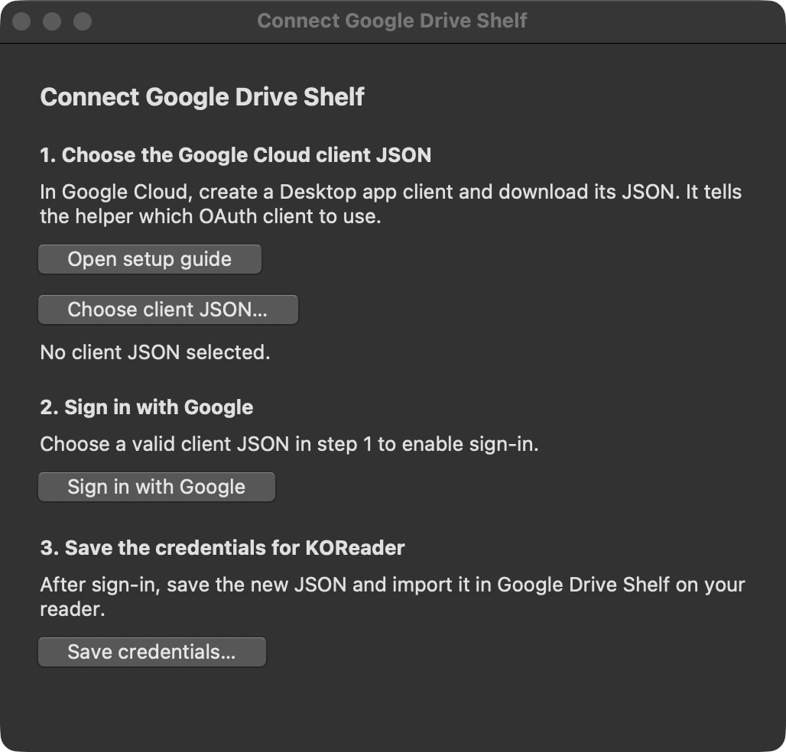
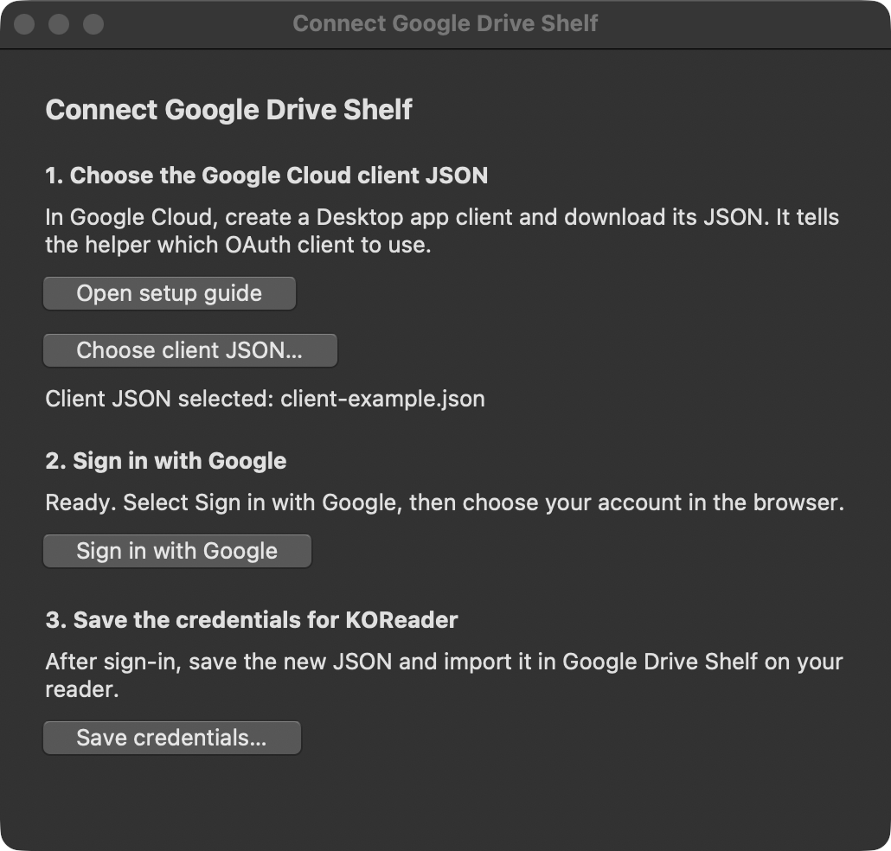
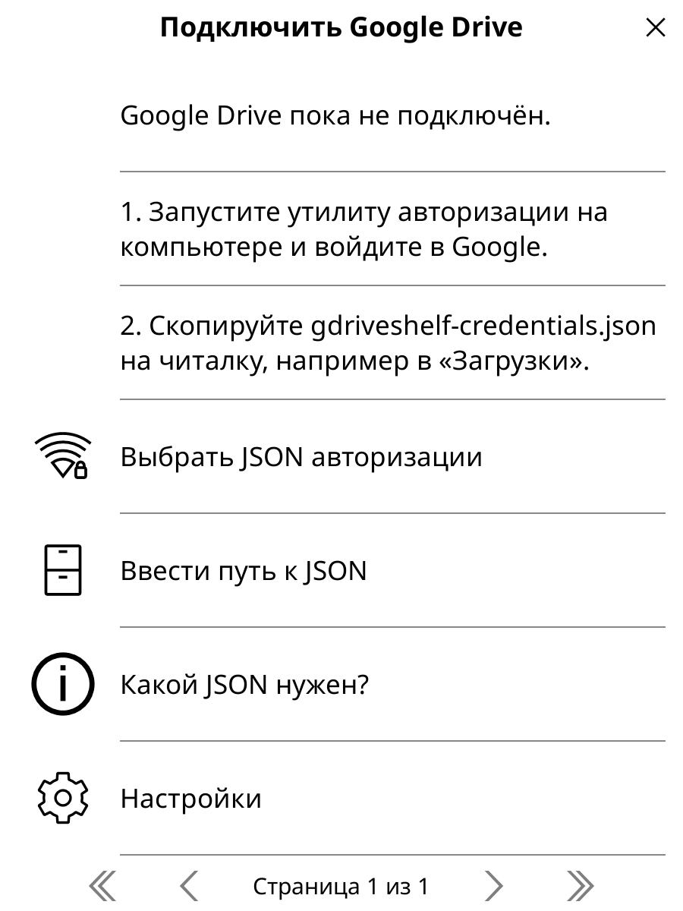

[English](authentication.md) · [К README](../README.ru.md)

# Подключение Google Drive

GDriveShelf использует ваш Google OAuth-клиент типа **Desktop app**. Графическая утилита на компьютере открывает вход в Google и сохраняет JSON для переноса на читалку.

## 1. Создайте Desktop app клиент

1. Откройте [Google Cloud Console](https://console.cloud.google.com/) и создайте или выберите проект.
2. Включите для проекта **Google Drive API**.
3. Настройте экран согласия OAuth. Если приложение находится в режиме **Testing**, добавьте нужный Google-аккаунт в тестовые пользователи.
4. Создайте OAuth-клиент с типом приложения **Desktop app** и скачайте его JSON.

Нужен JSON Desktop-клиента с конфигурацией `installed`. Клиент веб-приложения и ключ сервисного аккаунта для этой утилиты не подходят. Настройки проекта и согласия описаны в [документации Google для Desktop OAuth](https://developers.google.com/identity/protocols/oauth2/native-app).

## 2. Войдите в Google и сохраните файл

Скачайте [gdriveshelf-authorize.py](https://github.com/mewforest/gdriveshelf.koplugin/releases/latest/download/gdriveshelf-authorize.py) из релиза. Откройте терминал в папке загрузки и запустите команду для вашей системы.

| Система | Команда |
| --- | --- |
| Windows (PowerShell) | `py -3 .\gdriveshelf-authorize.py` |
| macOS или Linux | `python3 ./gdriveshelf-authorize.py` |

Если на Windows Python 3 запускается у вас командой `python`, используйте её вместо `py -3`. Утилита использует стандартный модуль Tkinter. Некоторые дистрибутивы Linux поставляют поддержку Tk отдельным пакетом, например `python3-tk` в Debian и Ubuntu.

1. Нажмите **Choose client JSON…** и выберите скачанный в Google Cloud JSON Desktop-клиента.
2. Нажмите **Sign in with Google**, выберите аккаунт в браузере и проверьте разрешения. Пароль вводится только на странице входа Google.
3. Вернитесь в окно утилиты и сохраните `gdriveshelf-credentials.json` в приватную папку.

| Выбор JSON клиента | JSON выбран, можно войти в Google |
| :---: | :---: |
| <a href="screenshots/authorize-desktop-choose.png"></a> | <a href="screenshots/authorize-desktop-ready.png"></a> |

Утилита запрашивает полный доступ к Google Drive (`https://www.googleapis.com/auth/drive`), чтобы плагин мог читать существующую библиотеку и синхронизировать нативный прогресс `.sdr` рядом с книгами. При входе файлы на Drive не меняются.

<details>
<summary>Запуск из терминала без графического окна</summary>

Windows (PowerShell):

```powershell
py -3 .\gdriveshelf-authorize.py --client ".\client.json" --output ".\gdriveshelf-credentials.json"
```

macOS или Linux:

```sh
python3 ./gdriveshelf-authorize.py --client "./client.json" --output "./gdriveshelf-credentials.json"
```

Из каталога исходников используйте `tools/authorize.py` вместо имени файла из релиза. В обоих режимах утилита использует PKCE S256 и временный callback на `127.0.0.1`. Время ожидания браузера — 180 секунд. Если нужно больше, добавьте `--timeout 300`. Не передавайте callback URL другим людям.

</details>

<details>
<summary>Только Android: авторизация через Termux</summary>

Это запасной вариант, если под рукой нет компьютера. Установите [Termux](https://github.com/termux/termux-app#installation) и создайте в Google Cloud такой же OAuth-клиент **Desktop app**. Сохраните его JSON в папку «Загрузки» Android под именем `client.json`. Для входа в Google понадобится обычный браузер.

Выполните `termux-setup-storage`, разрешите доступ к файлам и вернитесь в Termux. Когда появится `~/storage/downloads`, вставьте этот блок:

```sh
pkg install python curl coreutils &&
mkdir -p "$HOME/gdriveshelf-auth" &&
cd "$HOME/gdriveshelf-auth" &&
curl -fsSLO https://github.com/mewforest/gdriveshelf.koplugin/releases/latest/download/gdriveshelf-authorize.py &&
curl -fsSLO https://github.com/mewforest/gdriveshelf.koplugin/releases/latest/download/gdriveshelf-authorize.py.sha256 &&
sha256sum -c gdriveshelf-authorize.py.sha256 &&
python ./gdriveshelf-authorize.py --termux \
  --client "$HOME/storage/downloads/client.json" \
  --output "$HOME/gdriveshelf-auth/gdriveshelf-credentials.json"
```

Оставьте Termux запущенным, пока Google открывается в браузере. После успешного входа скопируйте готовый JSON в «Загрузки» для импорта в KOReader:

```sh
cp -i "$HOME/gdriveshelf-auth/gdriveshelf-credentials.json" "$HOME/storage/downloads/"
```

После импорта удалите копию из «Загрузок». Если Android не даёт открыть общую папку напрямую, попробуйте перенести оба файла через системный выбор файлов и раздел **Termux**, если он доступен. В `--client` укажите локальный путь к перенесённому JSON клиента. Если браузер не может вернуться на локальный адрес утилиты, воспользуйтесь способом для компьютера.

</details>

## 3. Импортируйте JSON в KOReader

1. Перенесите `gdriveshelf-credentials.json` в доступную KOReader папку.
2. Откройте **Google Drive Shelf**: на стартовом экране подключения нажмите **«Выбрать JSON авторизации»**. Импорт также доступен в разделе **«Настройки → Подключение и запуск»**.
3. Укажите созданный файл авторизации, а не исходный JSON OAuth-клиента.
4. После успешного импорта удалите ненужные копии из Downloads и с устройства переноса.

Папка «Загрузки» подходит; в папку плагина класть файл не нужно. На Android обычный путь — `/storage/emulated/0/Download/gdriveshelf-credentials.json`. Выбор файла начинается с домашней папки KOReader. Можно также нажать **«Ввести путь к JSON»**. Если KOReader не может прочитать файл, проверьте разрешение на доступ к памяти в настройках Android.

Созданный JSON содержит конфигурацию OAuth-клиента, access и refresh token, срок действия, scope, стабильный `account_id` из Drive `user.permissionId` и адрес аккаунта для отображения. Утилита сохраняет его атомарно и не выводит токены. На POSIX выставляются права `0600`. На Windows сохраняйте файл в папку, доступную только вашему пользователю. Плагин хранит собственную приватную локальную копию и сохраняет в неё обновлённые токены.

Не добавляйте оба JSON в Git, архивы плагина, вложения к issue, журналы или чаты. Получивший файл авторизации может получить доступ к вашему Drive.



## Обновление и отзыв доступа

При `invalid_grant` или отзыве доступа повторите авторизацию и импортируйте новый JSON. Если Google не выдал refresh token, повторите согласие; может потребоваться предварительно отозвать старое разрешение. Для приложений в режиме Testing срок жизни refresh token может быть ограничен правилами Google OAuth.

Для прекращения доступа удалите разрешение приложения в [подключениях Google-аккаунта](https://myaccount.google.com/connections). Одно лишь удаление локального JSON не отзывает разрешение.

## Проверка HTTPS

Плагин проверяет цепочку сертификатов и имя сервера до отправки HTTP-заголовков. Перенаправления запрещены, чтобы учётные данные не попадали на другой узел. Включённый Mozilla CA bundle получен из [curl CA Extract](https://curl.se/docs/caextract.html); источник, контрольная сумма и лицензия указаны в [CA-BUNDLE.md](../gdriveshelf.koplugin/CA-BUNDLE.md). Отключить проверку сертификатов в настройках нельзя. Python-утилита использует стандартный SSL context с проверкой сертификата.

Через `socketutil` KOReader задаются таймауты: 15 секунд для блокирующего ввода и 120 секунд для передачи после начала запроса. DNS-резолвинг остаётся за их пределами. Ошибки API содержат безопасный код и HTTP-статус без тела ответа и токенов.
